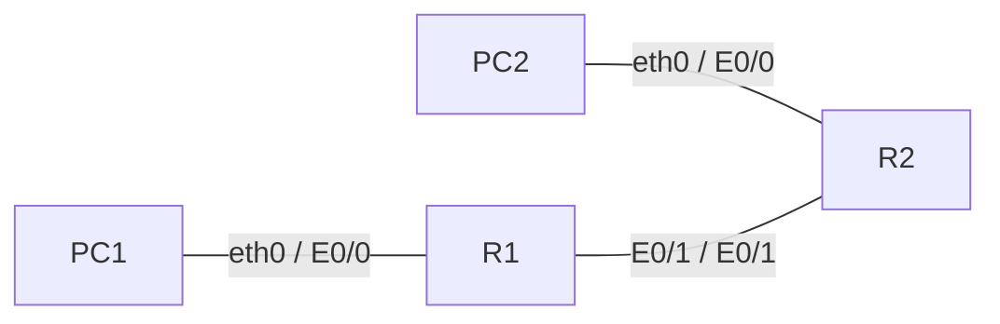
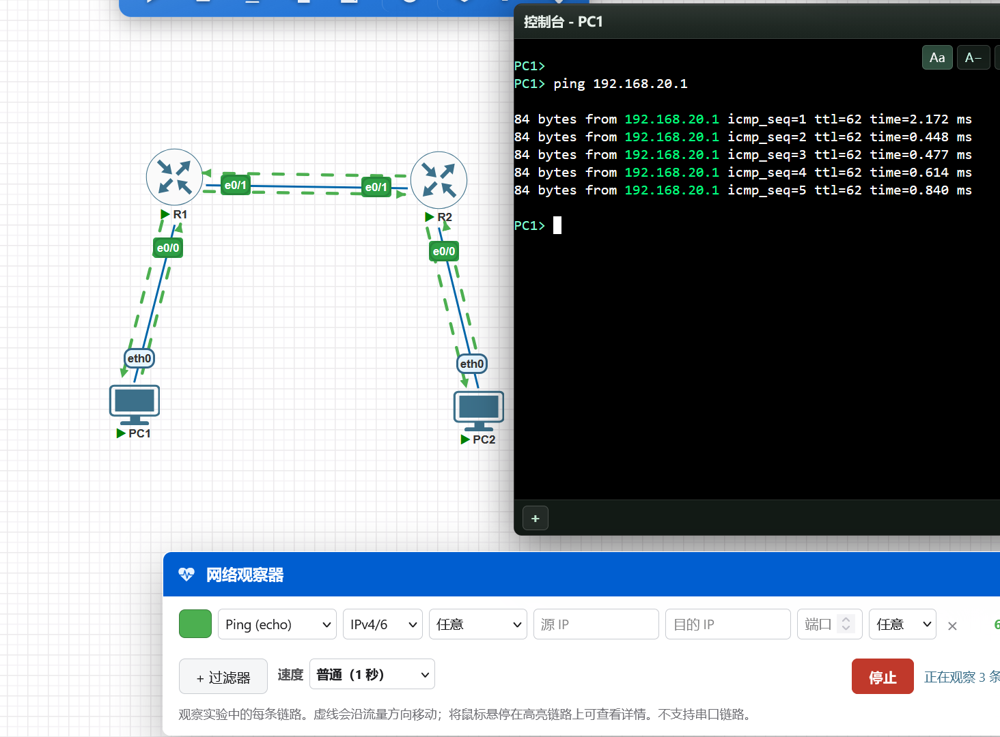

# 5.CCNP Enterprise作业五——IPv4 基础

## 作业主题

IPv4 基础与静态路由

## 作业目标

1. 掌握 IPv4 地址与子网掩码的基础配置
2. 理解不同网段之间通信需要经过三层路由转发
3. 掌握路由器接口 IP 地址配置方法
4. 掌握静态路由的配置与验证方法
5. 理解 PC1 ping PC2 的完整通信过程

------

## 实验拓扑



## 接口及 IP 地址规划

| 设备 | 接口 | 类型 | 规划              |
| ---- | ---- | ---- | ----------------- |
| R1   | E0/0 | -    | 192.168.10.254/24 |
| R1   | E0/1 | -    | 10.1.12.1/24      |
| R2   | E0/0 | -    | 192.168.20.254/24 |
| R2   | E0/1 | -    | 10.1.12.2/24      |
| PC1  | eth0 | -    | 192.168.10.1/24   |
| PC2  | eth0 | -    | 192.168.20.1/24   |

## 接口连接规划

| 设备 | 接口 | 连接设备 | 连接接口 |
| ---- | ---- | -------- | -------- |
| PC1  | eth0 | R1       | E0/0     |
| R1   | E0/1 | R2       | E0/1     |
| R2   | E0/0 | PC2      | eth0     |

## 网关规划

| 设备 | 默认网关       |
| ---- | -------------- |
| PC1  | 192.168.10.254 |
| PC2  | 192.168.20.254 |

## 静态路由规划

| 设备 | 目的网段        | 下一跳地址 |
| ---- | --------------- | ---------- |
| R1   | 192.168.20.0/24 | 10.1.12.2  |
| R2   | 192.168.10.0/24 | 10.1.12.1  |

------

## 配置需求

1. 根据实验拓扑完成设备连接与基础配置
2. 按照规划表完成 R1、R2 的接口 IP 地址配置
3. 按照规划表完成 PC1、PC2 的 IP 地址与默认网关配置
4. 在 R1 上配置到达 PC2 所在网段的静态路由
5. 在 R2 上配置到达 PC1 所在网段的静态路由
6. 验证 R1、R2 的直连路由和静态路由是否正确生成
7. 验证 PC1 与 PC2 是否可以互相通信

------

## 作业要求

1. 请给出 R1、R2、PC1、PC2 的最终配置，并给出 PC1 ping PC2 成功的验证截图
R1
```

!
! Last configuration change at 10:23:31 UTC Fri Oct 16 2026
!
version 15.7
service timestamps debug datetime msec
service timestamps log datetime msec
no service password-encryption
!
hostname R1
!
boot-start-marker
boot-end-marker
!
!
!
no aaa new-model
!
!
!
mmi polling-interval 60
no mmi auto-configure
no mmi pvc
mmi snmp-timeout 180
!
!
!
!
!
!
!
!
!
!
!
!
!
!
!


!
!
!
!
no ip domain lookup
ip cef
no ipv6 cef
!
multilink bundle-name authenticated
!
!
!
!
!
!
!
!
!
!
redundancy
!
!
! 
!
!
!
!
!
!
!
!
!
!
!
!
interface Ethernet0/0
 no shutdown
 description to-PC1
 ip address 192.168.10.254 255.255.255.0
 duplex auto
!
interface Ethernet0/1
 no shutdown
 description to-R2
 ip address 10.1.12.1 255.255.255.0
 duplex auto
!
interface Ethernet0/2
 no shutdown
 no ip address
 shutdown
 duplex auto
!
interface Ethernet0/3
 no shutdown
 no ip address
 shutdown
 duplex auto
!
interface Ethernet1/0
 no shutdown
 no ip address
 shutdown
 duplex auto
!
interface Ethernet1/1
 no shutdown
 no ip address
 shutdown
 duplex auto
!
interface Ethernet1/2
 no shutdown
 no ip address
 shutdown
 duplex auto
!
interface Ethernet1/3
 no shutdown
 no ip address
 shutdown
 duplex auto
!
interface Ethernet2/0
 no shutdown
 no ip address
 shutdown
 duplex auto
!
interface Ethernet2/1
 no shutdown
 no ip address
 shutdown
 duplex auto
!
interface Ethernet2/2
 no shutdown
 no ip address
 shutdown
 duplex auto
!
interface Ethernet2/3
 no shutdown
 no ip address
 shutdown
 duplex auto
!
interface Ethernet3/0
 no shutdown
 no ip address
 shutdown
 duplex auto
!
interface Ethernet3/1
 no shutdown
 no ip address
 shutdown
 duplex auto
!
interface Ethernet3/2
 no shutdown
 no ip address
 shutdown
 duplex auto
!
interface Ethernet3/3
 no shutdown
 no ip address
 shutdown
 duplex auto
!
ip forward-protocol nd
!
!
no ip http server
no ip http secure-server
ip route 192.168.20.0 255.255.255.0 10.1.12.2
!
ipv6 ioam timestamp
!
!
!
control-plane
!
!
!
!
!
!
!
!
line con 0
 logging synchronous
line aux 0
line vty 0 4
 login
 transport input none
!
!
end

```

R2
```

!
! Last configuration change at 10:22:36 UTC Fri Oct 16 2026
!
version 15.7
service timestamps debug datetime msec
service timestamps log datetime msec
no service password-encryption
!
hostname R2
!
boot-start-marker
boot-end-marker
!
!
!
no aaa new-model
!
!
!
mmi polling-interval 60
no mmi auto-configure
no mmi pvc
mmi snmp-timeout 180
!
!
!
!
!
!
!
!
!
!
!
!
!
!
!


!
!
!
!
ip cef
no ipv6 cef
!
multilink bundle-name authenticated
!
!
!
!
!
!
!
!
!
!
redundancy
!
!
! 
!
!
!
!
!
!
!
!
!
!
!
!
interface Ethernet0/0
 no shutdown
 description to-PC2
 ip address 192.168.20.254 255.255.255.0
 duplex auto
!
interface Ethernet0/1
 no shutdown
 description to-R1
 ip address 10.1.12.2 255.255.255.0
 duplex auto
!
interface Ethernet0/2
 no shutdown
 no ip address
 shutdown
 duplex auto
!
interface Ethernet0/3
 no shutdown
 no ip address
 shutdown
 duplex auto
!
interface Ethernet1/0
 no shutdown
 no ip address
 shutdown
 duplex auto
!
interface Ethernet1/1
 no shutdown
 no ip address
 shutdown
 duplex auto
!
interface Ethernet1/2
 no shutdown
 no ip address
 shutdown
 duplex auto
!
interface Ethernet1/3
 no shutdown
 no ip address
 shutdown
 duplex auto
!
interface Ethernet2/0
 no shutdown
 no ip address
 shutdown
 duplex auto
!
interface Ethernet2/1
 no shutdown
 no ip address
 shutdown
 duplex auto
!
interface Ethernet2/2
 no shutdown
 no ip address
 shutdown
 duplex auto
!
interface Ethernet2/3
 no shutdown
 no ip address
 shutdown
 duplex auto
!
interface Ethernet3/0
 no shutdown
 no ip address
 shutdown
 duplex auto
!
interface Ethernet3/1
 no shutdown
 no ip address
 shutdown
 duplex auto
!
interface Ethernet3/2
 no shutdown
 no ip address
 shutdown
 duplex auto
!
interface Ethernet3/3
 no shutdown
 no ip address
 shutdown
 duplex auto
!
ip forward-protocol nd
!
!
no ip http server
no ip http secure-server
ip route 192.168.10.0 255.255.255.0 10.1.12.1
!
ipv6 ioam timestamp
!
!
!
control-plane
!
!
!
!
!
!
!
!
line con 0
 logging synchronous
line aux 0
line vty 0 4
 login
 transport input none
!
!
end

```

PC1
```
set pcname PC1
ip 192.168.10.1 24 192.168.10.254
```

PC2
```
set pcname PC2
ip 192.168.20.1 255.255.255.0
```




2. 请详细说明 PC1 ping PC2 的完整通信过程，包括 ARP、默认网关、路由查表、二层封装变化、ICMP Echo Request 与 Echo Reply 的返回路径(三层包交付过程)
   1. PC1 用自己的掩码和目的地址做与运算,,发现跟自己不在同一网段,将包交给网关r1
   2. PC1 ARP 解析默认网关的 MAC,,此时包 源mac:pc1,目的mac:r1mac,源ip:192.168.1.1,目的ip:192.168.20.1
   3. R1 处理：查表 + 重封装  
    R1 剥掉二层帧头，把包交给三层。  
    R1 查路由表根据最长前缀匹配：192.168.20.0/24 命中静态路由  
    R1 ARP 解析下一跳10.1.12.2
    重新封装并转发
   4.  R2 处理：查表 + 重封装,并ARP 解析目的主机pc2
   5.  PC2 收到 Echo Request 并生成 Echo Reply  
       源 IP	192.168.20.1（交换了！）
       目的 IP	192.168.10.1（交换了！）
   6. 按照上述回包