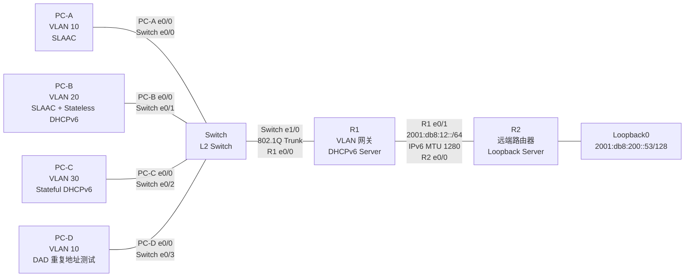

# 6.CCNP Enterprise作业六——IPv6 基础

## 作业主题

IPv6 基础、NDP、SLAAC 与 DHCPv6

## 作业目标

1. 掌握 IPv6 地址、前缀和 Link-Local 地址的基础配置
2. 理解 IPv6 中 RS、RA、NS、NA 与 NDP 的工作过程
3. 掌握 SLAAC、Stateless DHCPv6、Stateful DHCPv6 的配置与验证方法
4. 掌握 IPv6 静态路由的配置与验证方法
5. 理解 IPv6 中 DAD、NUD 与 PMTUD 的基本现象

------

## 实验拓扑

## 设备角色规划

| 设备   | 作用                                                         |
| ------ | ------------------------------------------------------------ |
| R1     | VLAN 10、VLAN 20、VLAN 30 的默认网关，同时作为 DHCPv6 Server |
| R2     | 远端 IPv6 路由器，提供 Loopback0 测试地址                    |
| Switch | 二层交换机，划分 VLAN 10、VLAN 20、VLAN 30                   |
| PC-A   | VLAN 10 客户端，通过 SLAAC 获取 IPv6 地址                    |
| PC-B   | VLAN 20 客户端，通过 SLAAC 获取地址，通过 Stateless DHCPv6 获取其他参数 |
| PC-C   | VLAN 30 客户端，通过 Stateful DHCPv6 获取 IPv6 地址          |
| PC-D   | VLAN 10 客户端，用于验证 DAD 重复地址检测                    |

## 接口连接规划

| 连接           | 本端接口     | 对端接口    | 说明                               |
| -------------- | ------------ | ----------- | ---------------------------------- |
| PC-A 到 Switch | PC-A E0/0    | Switch E0/0 | VLAN 10，SLAAC only                |
| PC-B 到 Switch | PC-B E0/0    | Switch E0/1 | VLAN 20，SLAAC + Stateless DHCPv6  |
| PC-C 到 Switch | PC-C E0/0    | Switch E0/2 | VLAN 30，Stateful DHCPv6           |
| PC-D 到 Switch | PC-D E0/0    | Switch E0/3 | VLAN 10，DAD 重复地址测试          |
| Switch 到 R1   | Switch E1/0  | R1 E0/0     | 802.1Q Trunk，承载 VLAN 10、20、30 |
| R1 到 R2       | R1 E0/1      | R2 E0/0     | 三层点到点链路                     |
| R2 到 Loopback | R2 Loopback0 | -           | 远端 IPv6 测试地址                 |

## 接口及 IPv6 地址规划

| 网段         | 用途                     | 前缀                   | 网关或地址                               |
| ------------ | ------------------------ | ---------------------- | ---------------------------------------- |
| VLAN 10      | SLAAC only               | `2001:db8:100:10::/64` | `2001:db8:100:10::1`                     |
| VLAN 20      | SLAAC + Stateless DHCPv6 | `2001:db8:100:20::/64` | `2001:db8:100:20::1`                     |
| VLAN 30      | Stateful DHCPv6          | `2001:db8:100:30::/64` | `2001:db8:100:30::1`                     |
| R1-R2        | 点到点链路               | `2001:db8:12::/64`     | R1 `2001:db8:12::1`，R2 `2001:db8:12::2` |
| R2 Loopback0 | 远端测试地址             | `2001:db8:200::53/128` | `2001:db8:200::53`                       |

## VLAN 与接入方式规划

| VLAN    | 终端 | Switch 接口 | 地址获取方式             | RA / DHCPv6 要求                  |
| ------- | ---- | ----------- | ------------------------ | --------------------------------- |
| VLAN 10 | PC-A | E0/0        | SLAAC only               | RA 通告前缀，`M=0`，`O=0`         |
| VLAN 10 | PC-D | E0/3        | 手工配置重复地址         | 用于触发 DAD 失败                 |
| VLAN 20 | PC-B | E0/1        | SLAAC + Stateless DHCPv6 | RA 通告前缀，`M=0`，`O=1`         |
| VLAN 30 | PC-C | E0/2        | Stateful DHCPv6          | RA 设置 `M=1`，地址由 DHCPv6 分配 |

## 静态路由规划

| 设备 | 目的网段            | 下一跳地址       |
| ---- | ------------------- | ---------------- |
| R1   | `2001:db8:200::/64` | `2001:db8:12::2` |
| R2   | `2001:db8:100::/48` | `2001:db8:12::1` |

## 实验观察规划

| 实验项目         | 观察对象                                                  |
| ---------------- | --------------------------------------------------------- |
| SLAAC            | PC-A 获取 IPv6 地址、默认网关与 RA 前缀                   |
| Stateless DHCPv6 | PC-B 通过 SLAAC 获取地址，通过 DHCPv6 获取 DNS 等其他参数 |
| Stateful DHCPv6  | PC-C 通过 DHCPv6 获取 IPv6 地址，默认网关仍来自 RA        |
| DAD              | PC-D 与 PC-A 配置重复地址后，观察重复地址检测结果         |
| NDP              | 观察 NS、NA、邻居表项生成与邻居状态变化                   |
| PMTUD            | R1-R2 链路 IPv6 MTU 设置为 1280，观察 Packet Too Big      |
| IPv6 静态路由    | PC-A、PC-B、PC-C 到 R2 Loopback0 的跨网段通信             |

------

## 配置需求

1. 根据实验拓扑完成设备连接与基础配置
2. 在 Switch 上创建 VLAN 10、VLAN 20、VLAN 30
3. 将 Switch 的 E0/0、E0/3 配置为 Access 端口并加入 VLAN 10
4. 将 Switch 的 E0/1 配置为 Access 端口并加入 VLAN 20
5. 将 Switch 的 E0/2 配置为 Access 端口并加入 VLAN 30
6. 将 Switch 的 E1/0 配置为 Trunk，并允许 VLAN 10、VLAN 20、VLAN 30 通过
7. 在 R1 上启用 IPv6 单播路由功能
8. 在 R1 的 E0/0 上配置 Router-on-a-Stick 子接口，分别作为 VLAN 10、VLAN 20、VLAN 30 的 IPv6 网关
9. 在 R1 上配置 VLAN 20 的 Stateless DHCPv6 服务
10. 在 R1 上配置 VLAN 30 的 Stateful DHCPv6 服务
11. 在 R1、R2 的点到点链路上配置 IPv6 地址，并将 IPv6 MTU 设置为 1280
12. 在 R2 上配置 Loopback0 地址 `2001:db8:200::53/128`
13. 在 R1、R2 上配置 IPv6 静态路由，实现各 VLAN 与 R2 Loopback0 的互通
14. 按照规划分别完成 PC-A、PC-B、PC-C、PC-D 的 IPv6 客户端配置
15. 验证 SLAAC、Stateless DHCPv6、Stateful DHCPv6、DAD、NDP、PMTUD 与 IPv6 静态路由现象

------

## 作业要求

1. 请给出 R1、R2、Switch、PC-A、PC-B、PC-C、PC-D 的最终配置，并按照设备进行分类
2. 请给出 PC-A、PC-B、PC-C 获取 IPv6 地址和默认网关的验证截图
3. 请给出 R1 上 DHCPv6 Pool 和 DHCPv6 Binding 的验证截图
4. 请给出 R1、R2 的 IPv6 路由表验证截图
5. 请给出 PC-A、PC-B、PC-C ping `2001:db8:200::53` 成功的验证截图
6. 请抓包或截图说明 PC-A 使用 SLAAC 时 RS、RA、DAD 报文的出现顺序
7. 请抓包或截图说明 PC-B 使用 Stateless DHCPv6 时 RA 与 DHCPv6 报文的作用
8. 请抓包或截图说明 PC-C 使用 Stateful DHCPv6 时地址分配过程
9. 请通过 PC-D 制造 IPv6 重复地址，并说明 DAD 失败的现象和原因
10. 请使用大包 ping 测试 PMTUD，并说明 ICMPv6 Packet Too Big 的触发原因
11. 请说明 IPv6 中为什么不使用 ARP，以及 NDP 中 NS、NA 分别承担什么作用
12. 请说明 PC-A ping R2 Loopback0 的完整通信过程，包括默认网关获取、邻居发现、路由查表、Hop Limit 变化、二层封装变化与 Echo Reply 返回路径