# 6.CCNP Enterprise作业六——IPv6 基础

## 作业主题

IPv6 基础、NDP、SLAAC 与 DHCPv6

## 作业目标

1. 掌握 IPv6 地址、前缀和 Link-Local 地址的基础配置
2. 理解 IPv6 中 RS、RA、NS、NA 与 NDP 的工作过程
3. 掌握 SLAAC、Stateless DHCPv6、Stateful DHCPv6 的配置与验证方法
4. 掌握 IPv6 静态路由的配置与验证方法
5. 理解 IPv6 中 DAD、NUD 与 PMTUD 的基本现象

------

## 实验拓扑

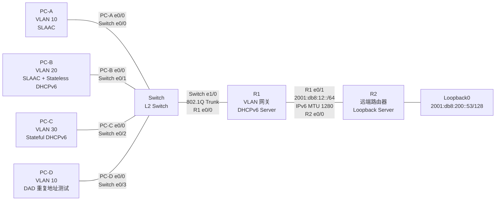

## 设备角色规划

| 设备   | 作用                                                         |
| ------ | ------------------------------------------------------------ |
| R1     | VLAN 10、VLAN 20、VLAN 30 的默认网关，同时作为 DHCPv6 Server |
| R2     | 远端 IPv6 路由器，提供 Loopback0 测试地址                    |
| Switch | 二层交换机，划分 VLAN 10、VLAN 20、VLAN 30                   |
| PC-A   | VLAN 10 客户端，通过 SLAAC 获取 IPv6 地址                    |
| PC-B   | VLAN 20 客户端，通过 SLAAC 获取地址，通过 Stateless DHCPv6 获取其他参数 |
| PC-C   | VLAN 30 客户端，通过 Stateful DHCPv6 获取 IPv6 地址          |
| PC-D   | VLAN 10 客户端，用于验证 DAD 重复地址检测                    |

## 接口连接规划

| 连接           | 本端接口     | 对端接口    | 说明                               |
| -------------- | ------------ | ----------- | ---------------------------------- |
| PC-A 到 Switch | PC-A E0/0    | Switch E0/0 | VLAN 10，SLAAC only                |
| PC-B 到 Switch | PC-B E0/0    | Switch E0/1 | VLAN 20，SLAAC + Stateless DHCPv6  |
| PC-C 到 Switch | PC-C E0/0    | Switch E0/2 | VLAN 30，Stateful DHCPv6           |
| PC-D 到 Switch | PC-D E0/0    | Switch E0/3 | VLAN 10，DAD 重复地址测试          |
| Switch 到 R1   | Switch E1/0  | R1 E0/0     | 802.1Q Trunk，承载 VLAN 10、20、30 |
| R1 到 R2       | R1 E0/1      | R2 E0/0     | 三层点到点链路                     |
| R2 到 Loopback | R2 Loopback0 | -           | 远端 IPv6 测试地址                 |

## 接口及 IPv6 地址规划

| 网段         | 用途                     | 前缀                   | 网关或地址                               |
| ------------ | ------------------------ | ---------------------- | ---------------------------------------- |
| VLAN 10      | SLAAC only               | `2001:db8:100:10::/64` | `2001:db8:100:10::1`                     |
| VLAN 20      | SLAAC + Stateless DHCPv6 | `2001:db8:100:20::/64` | `2001:db8:100:20::1`                     |
| VLAN 30      | Stateful DHCPv6          | `2001:db8:100:30::/64` | `2001:db8:100:30::1`                     |
| R1-R2        | 点到点链路               | `2001:db8:12::/64`     | R1 `2001:db8:12::1`，R2 `2001:db8:12::2` |
| R2 Loopback0 | 远端测试地址             | `2001:db8:200::53/128` | `2001:db8:200::53`                       |

## VLAN 与接入方式规划

| VLAN    | 终端 | Switch 接口 | 地址获取方式             | RA / DHCPv6 要求                  |
| ------- | ---- | ----------- | ------------------------ | --------------------------------- |
| VLAN 10 | PC-A | E0/0        | SLAAC only               | RA 通告前缀，`M=0`，`O=0`         |
| VLAN 10 | PC-D | E0/3        | 手工配置重复地址         | 用于触发 DAD 失败                 |
| VLAN 20 | PC-B | E0/1        | SLAAC + Stateless DHCPv6 | RA 通告前缀，`M=0`，`O=1`         |
| VLAN 30 | PC-C | E0/2        | Stateful DHCPv6          | RA 设置 `M=1`，地址由 DHCPv6 分配 |

## 静态路由规划

| 设备 | 目的网段            | 下一跳地址       |
| ---- | ------------------- | ---------------- |
| R1   | `2001:db8:200::/64` | `2001:db8:12::2` |
| R2   | `2001:db8:100::/48` | `2001:db8:12::1` |

## 实验观察规划

| 实验项目         | 观察对象                                                  |
| ---------------- | --------------------------------------------------------- |
| SLAAC            | PC-A 获取 IPv6 地址、默认网关与 RA 前缀                   |
| Stateless DHCPv6 | PC-B 通过 SLAAC 获取地址，通过 DHCPv6 获取 DNS 等其他参数 |
| Stateful DHCPv6  | PC-C 通过 DHCPv6 获取 IPv6 地址，默认网关仍来自 RA        |
| DAD              | PC-D 与 PC-A 配置重复地址后，观察重复地址检测结果         |
| NDP              | 观察 NS、NA、邻居表项生成与邻居状态变化                   |
| PMTUD            | R1-R2 链路 IPv6 MTU 设置为 1280，观察 Packet Too Big      |
| IPv6 静态路由    | PC-A、PC-B、PC-C 到 R2 Loopback0 的跨网段通信             |

------

## 配置需求

1. 根据实验拓扑完成设备连接与基础配置
2. 在 Switch 上创建 VLAN 10、VLAN 20、VLAN 30
3. 将 Switch 的 E0/0、E0/3 配置为 Access 端口并加入 VLAN 10
4. 将 Switch 的 E0/1 配置为 Access 端口并加入 VLAN 20
5. 将 Switch 的 E0/2 配置为 Access 端口并加入 VLAN 30
6. 将 Switch 的 E1/0 配置为 Trunk，并允许 VLAN 10、VLAN 20、VLAN 30 通过
7. 在 R1 上启用 IPv6 单播路由功能
8. 在 R1 的 E0/0 上配置 Router-on-a-Stick 子接口，分别作为 VLAN 10、VLAN 20、VLAN 30 的 IPv6 网关
9. 在 R1 上配置 VLAN 20 的 Stateless DHCPv6 服务
10. 在 R1 上配置 VLAN 30 的 Stateful DHCPv6 服务
11. 在 R1、R2 的点到点链路上配置 IPv6 地址，并将 IPv6 MTU 设置为 1280
12. 在 R2 上配置 Loopback0 地址 `2001:db8:200::53/128`
13. 在 R1、R2 上配置 IPv6 静态路由，实现各 VLAN 与 R2 Loopback0 的互通
14. 按照规划分别完成 PC-A、PC-B、PC-C、PC-D 的 IPv6 客户端配置
15. 验证 SLAAC、Stateless DHCPv6、Stateful DHCPv6、DAD、NDP、PMTUD 与 IPv6 静态路由现象

------

## 作业要求

1. 请给出 R1、R2、Switch、PC-A、PC-B、PC-C、PC-D 的最终配置，并按照设备进行分类  
    ### R1
    ```
        
    !
    ! Last configuration change at 11:25:54 UTC Mon Oct 19 2026
    !
    version 15.7
    service timestamps debug datetime msec
    service timestamps log datetime msec
    no service password-encryption
    !
    hostname R1
    !
    boot-start-marker
    boot-end-marker
    !
    !
    !
    no aaa new-model
    !
    !
    !
    mmi polling-interval 60
    no mmi auto-configure
    no mmi pvc
    mmi snmp-timeout 180
    !
    !
    !
    !
    !
    no ip icmp rate-limit unreachable
    !
    !
    !
    !
    !
    !
    !
    !
    !
    !


    !
    !
    !
    !
    no ip domain lookup
    ip cef
    ipv6 unicast-routing
    ipv6 cef
    ipv6 dhcp pool v20-stateless
    dns-server 2001:DB8:200::53
    domain-name ccnp.lab
    !
    ipv6 dhcp pool v30-stateful
    address prefix 2001:DB8:100:30::/64
    dns-server 2001:DB8:200::53
    domain-name ccnp.lab
    !
    !
    multilink bundle-name authenticated
    !
    !
    !
    !
    !
    !
    !
    !
    !
    !
    redundancy
    !
    no cdp log mismatch duplex
    !
    ip tcp synwait-time 5
    ! 
    !
    !
    !
    !
    !
    !
    !
    !
    !
    !
    !
    !
    interface Ethernet0/0
    no shutdown
    no ip address
    duplex auto
    !
    interface Ethernet0/0.10
    no shutdown
    description vlan10-slaac-only
    encapsulation dot1Q 10
    ipv6 address FE80::1 link-local
    ipv6 address 2001:DB8:100:10::1/64
    !
    interface Ethernet0/0.20
    no shutdown
    description vlan20-slaac-stateless-dhcpv6
    encapsulation dot1Q 20
    ipv6 address FE80::1 link-local
    ipv6 address 2001:DB8:100:20::1/64
    ipv6 nd other-config-flag
    ipv6 dhcp server v20-stateless
    !
    interface Ethernet0/0.30
    no shutdown
    description vlan30-stateful
    encapsulation dot1Q 30
    ipv6 address FE80::1 link-local
    ipv6 address 2001:DB8:100:30::1/64
    ipv6 nd prefix 2001:DB8:100:30::/64 no-advertise
    ipv6 nd managed-config-flag
    ipv6 dhcp server v30-stateful
    !
    interface Ethernet0/1
    no shutdown
    description r1-to-r2e0/0
    no ip address
    duplex auto
    ipv6 address FE80::1 link-local
    ipv6 address 2001:DB8:12::1/64
    ipv6 mtu 1280
    !
    interface Ethernet0/2
    no shutdown
    no ip address
    duplex auto
    !
    interface Ethernet0/3
    no shutdown
    no ip address
    duplex auto
    !
    interface Ethernet1/0
    no shutdown
    no ip address
    duplex auto
    !
    interface Ethernet1/1
    no shutdown
    no ip address
    duplex auto
    !
    interface Ethernet1/2
    no shutdown
    no ip address
    duplex auto
    !
    interface Ethernet1/3
    no shutdown
    no ip address
    duplex auto
    !
    interface Ethernet2/0
    no shutdown
    no ip address
    shutdown
    duplex auto
    !
    interface Ethernet2/1
    no shutdown
    no ip address
    shutdown
    duplex auto
    !
    interface Ethernet2/2
    no shutdown
    no ip address
    shutdown
    duplex auto
    !
    interface Ethernet2/3
    no shutdown
    no ip address
    shutdown
    duplex auto
    !
    interface Ethernet3/0
    no shutdown
    no ip address
    shutdown
    duplex auto
    !
    interface Ethernet3/1
    no shutdown
    no ip address
    shutdown
    duplex auto
    !
    interface Ethernet3/2
    no shutdown
    no ip address
    shutdown
    duplex auto
    !
    interface Ethernet3/3
    no shutdown
    no ip address
    shutdown
    duplex auto
    !
    ip forward-protocol nd
    !
    !
    no ip http server
    no ip http secure-server
    !
    ipv6 route 2001:DB8:200::/64 2001:DB8:12::2
    ipv6 ioam timestamp
    !
    !
    !
    control-plane
    !
    !
    !
    !
    !
    !
    !
    !
    line con 0
    exec-timeout 0 0
    privilege level 15
    logging synchronous
    line aux 0
    exec-timeout 0 0
    privilege level 15
    logging synchronous
    line vty 0 4
    login
    transport input none
    !
    !
    end

    ```
    ### R2
    ```
    !
    ! Last configuration change at 11:25:52 UTC Mon Oct 19 2026
    !
    version 15.7
    service timestamps debug datetime msec
    service timestamps log datetime msec
    no service password-encryption
    !
    hostname R2
    !
    boot-start-marker
    boot-end-marker
    !
    !
    !
    no aaa new-model
    !
    !
    !
    mmi polling-interval 60
    no mmi auto-configure
    no mmi pvc
    mmi snmp-timeout 180
    !
    !
    !
    !
    !
    no ip icmp rate-limit unreachable
    !
    !
    !
    !
    !
    !
    !
    !
    !
    !


    !
    !
    !
    !
    no ip domain lookup
    ip cef
    ipv6 unicast-routing
    ipv6 cef
    !
    multilink bundle-name authenticated
    !
    !
    !
    !
    !
    !
    !
    !
    !
    !
    redundancy
    !
    no cdp log mismatch duplex
    !
    ip tcp synwait-time 5
    ! 
    !
    !
    !
    !
    !
    !
    !
    !
    !
    !
    !
    !
    interface Loopback0
    no shutdown
    description remote-test-server
    no ip address
    ipv6 address 2001:DB8:200::53/128
    !
    interface Ethernet0/0
    no shutdown
    description r2-to-r1-e0/1
    no ip address
    duplex auto
    ipv6 address FE80::2 link-local
    ipv6 address 2001:DB8:12::2/64
    ipv6 mtu 1280
    !
    interface Ethernet0/1
    no shutdown
    no ip address
    duplex auto
    !
    interface Ethernet0/2
    no shutdown
    no ip address
    duplex auto
    !
    interface Ethernet0/3
    no shutdown
    no ip address
    duplex auto
    !
    interface Ethernet1/0
    no shutdown
    no ip address
    duplex auto
    !
    interface Ethernet1/1
    no shutdown
    no ip address
    duplex auto
    !
    interface Ethernet1/2
    no shutdown
    no ip address
    duplex auto
    !
    interface Ethernet1/3
    no shutdown
    no ip address
    duplex auto
    !
    interface Ethernet2/0
    no shutdown
    no ip address
    shutdown
    duplex auto
    !
    interface Ethernet2/1
    no shutdown
    no ip address
    shutdown
    duplex auto
    !
    interface Ethernet2/2
    no shutdown
    no ip address
    shutdown
    duplex auto
    !
    interface Ethernet2/3
    no shutdown
    no ip address
    shutdown
    duplex auto
    !
    interface Ethernet3/0
    no shutdown
    no ip address
    shutdown
    duplex auto
    !
    interface Ethernet3/1
    no shutdown
    no ip address
    shutdown
    duplex auto
    !
    interface Ethernet3/2
    no shutdown
    no ip address
    shutdown
    duplex auto
    !
    interface Ethernet3/3
    no shutdown
    no ip address
    shutdown
    duplex auto
    !
    ip forward-protocol nd
    !
    !
    no ip http server
    no ip http secure-server
    !
    ipv6 route ::/0 2001:DB8:12::1
    ipv6 ioam timestamp
    !
    !
    !
    control-plane
    !
    !
    !
    !
    !
    !
    !
    !
    line con 0
    exec-timeout 0 0
    privilege level 15
    logging synchronous
    line aux 0
    exec-timeout 0 0
    privilege level 15
    logging synchronous
    line vty 0 4
    login
    transport input none
    !
    !
    end

    ```
    ### SWITCHT

    ```
    !
    ! Last configuration change at 11:25:51 UTC Mon Oct 19 2026
    !
    version 15.2
    service timestamps debug datetime msec
    service timestamps log datetime msec
    no service password-encryption
    service compress-config
    !
    hostname SW1
    !
    boot-start-marker
    boot-end-marker
    !
    !
    !
    no aaa new-model
    !
    !
    !
    !
    !
    no ip icmp rate-limit unreachable
    !
    !
    !
    no ip domain-lookup
    ip cef
    no ipv6 cef
    !
    !
    !
    spanning-tree mode pvst
    spanning-tree extend system-id
    !
    !
    ! 
    !
    !
    !
    !
    !
    !
    !
    !
    !
    !
    !
    !
    interface Ethernet0/0
    no shutdown
    switchport access vlan 10
    switchport mode access
    spanning-tree portfast edge
    !
    interface Ethernet0/1
    no shutdown
    switchport access vlan 20
    switchport mode access
    spanning-tree portfast edge
    !
    interface Ethernet0/2
    no shutdown
    switchport access vlan 30
    switchport mode access
    spanning-tree portfast edge
    !
    interface Ethernet0/3
    no shutdown
    switchport access vlan 10
    switchport mode access
    spanning-tree portfast edge
    !
    interface Ethernet1/0
    no shutdown
    switchport trunk allowed vlan 10,20,30
    switchport trunk encapsulation dot1q
    switchport mode trunk
    !
    interface Ethernet1/1
    no shutdown
    !
    interface Ethernet1/2
    no shutdown
    !
    interface Ethernet1/3
    no shutdown
    !
    interface Ethernet2/0
    no shutdown
    !
    interface Ethernet2/1
    no shutdown
    !
    interface Ethernet2/2
    no shutdown
    !
    interface Ethernet2/3
    no shutdown
    !
    interface Ethernet3/0
    no shutdown
    !
    interface Ethernet3/1
    no shutdown
    !
    interface Ethernet3/2
    no shutdown
    !
    interface Ethernet3/3
    no shutdown
    !
    ip forward-protocol nd
    !
    ip tcp synwait-time 5
    ip http server
    !
    ip ssh server algorithm encryption aes128-ctr aes192-ctr aes256-ctr
    ip ssh client algorithm encryption aes128-ctr aes192-ctr aes256-ctr
    !
    !
    !
    !
    !
    control-plane
    !
    !
    line con 0
    exec-timeout 0 0
    privilege level 15
    logging synchronous
    line aux 0
    exec-timeout 0 0
    privilege level 15
    logging synchronous
    line vty 0 4
    login
    !
    !
    !
    end

    ```
    ### PC-A

    ```
    !
    ! Last configuration change at 10:49:39 UTC Mon Oct 19 2026
    !
    version 15.7
    service timestamps debug datetime msec
    service timestamps log datetime msec
    no service password-encryption
    !
    hostname PC-10-SLAAC
    !
    boot-start-marker
    boot-end-marker
    !
    !
    !
    no aaa new-model
    !
    !
    !
    mmi polling-interval 60
    no mmi auto-configure
    no mmi pvc
    mmi snmp-timeout 180
    !
    !
    !
    !
    !
    no ip icmp rate-limit unreachable
    !
    !
    !
    !
    !
    !
    !
    !
    !
    !


    !
    !
    !
    !
    no ip domain lookup
    ip cef
    no ipv6 cef
    !
    multilink bundle-name authenticated
    !
    !
    !
    !
    !
    !
    !
    !
    !
    !
    redundancy
    !
    no cdp log mismatch duplex
    !
    ip tcp synwait-time 5
    ! 
    !
    !
    !
    !
    !
    !
    !
    !
    !
    !
    !
    !
    interface Ethernet0/0
    no shutdown
    no ip address
    duplex auto
    ipv6 address autoconfig default
    ipv6 enable
    !
    interface Ethernet0/1
    no shutdown
    no ip address
    duplex auto
    !
    interface Ethernet0/2
    no shutdown
    no ip address
    duplex auto
    !
    interface Ethernet0/3
    no shutdown
    no ip address
    duplex auto
    !
    interface Ethernet1/0
    no shutdown
    no ip address
    duplex auto
    !
    interface Ethernet1/1
    no shutdown
    no ip address
    duplex auto
    !
    interface Ethernet1/2
    no shutdown
    no ip address
    duplex auto
    !
    interface Ethernet1/3
    no shutdown
    no ip address
    duplex auto
    !
    interface Ethernet2/0
    no shutdown
    no ip address
    shutdown
    duplex auto
    !
    interface Ethernet2/1
    no shutdown
    no ip address
    shutdown
    duplex auto
    !
    interface Ethernet2/2
    no shutdown
    no ip address
    shutdown
    duplex auto
    !
    interface Ethernet2/3
    no shutdown
    no ip address
    shutdown
    duplex auto
    !
    interface Ethernet3/0
    no shutdown
    no ip address
    shutdown
    duplex auto
    !
    interface Ethernet3/1
    no shutdown
    no ip address
    shutdown
    duplex auto
    !
    interface Ethernet3/2
    no shutdown
    no ip address
    shutdown
    duplex auto
    !
    interface Ethernet3/3
    no shutdown
    no ip address
    shutdown
    duplex auto
    !
    ip forward-protocol nd
    !
    !
    no ip http server
    no ip http secure-server
    !
    ipv6 ioam timestamp
    !
    !
    !
    control-plane
    !
    !
    !
    !
    !
    !
    !
    !
    line con 0
    exec-timeout 0 0
    privilege level 15
    logging synchronous
    line aux 0
    exec-timeout 0 0
    privilege level 15
    logging synchronous
    line vty 0 4
    login
    transport input none
    !
    !
    end

    ```
    ### PC-B
    ```

    !
    ! Last configuration change at 10:56:52 UTC Mon Oct 19 2026
    !
    version 15.7
    service timestamps debug datetime msec
    service timestamps log datetime msec
    no service password-encryption
    !
    hostname PC2-20-SLAAC+STARELESS
    !
    boot-start-marker
    boot-end-marker
    !
    !
    !
    no aaa new-model
    !
    !
    !
    mmi polling-interval 60
    no mmi auto-configure
    no mmi pvc
    mmi snmp-timeout 180
    !
    !
    !
    !
    !
    no ip icmp rate-limit unreachable
    !
    !
    !
    !
    !
    !
    !
    !
    !
    !


    !
    !
    !
    !
    ip domain list ccnp.lab
    no ip domain lookup
    ip cef
    no ipv6 cef
    !
    multilink bundle-name authenticated
    !
    !
    !
    !
    !
    !
    !
    !
    !
    !
    redundancy
    !
    no cdp log mismatch duplex
    !
    ip tcp synwait-time 5
    ! 
    !
    !
    !
    !
    !
    !
    !
    !
    !
    !
    !
    !
    interface Ethernet0/0
    no shutdown
    no ip address
    duplex auto
    ipv6 address autoconfig default
    ipv6 enable
    ipv6 dhcp client request vendor
    !
    interface Ethernet0/1
    no shutdown
    no ip address
    duplex auto
    !
    interface Ethernet0/2
    no shutdown
    no ip address
    duplex auto
    !
    interface Ethernet0/3
    no shutdown
    no ip address
    duplex auto
    !
    interface Ethernet1/0
    no shutdown
    no ip address
    duplex auto
    !
    interface Ethernet1/1
    no shutdown
    no ip address
    duplex auto
    !
    interface Ethernet1/2
    no shutdown
    no ip address
    duplex auto
    !
    interface Ethernet1/3
    no shutdown
    no ip address
    duplex auto
    !
    interface Ethernet2/0
    no shutdown
    no ip address
    shutdown
    duplex auto
    !
    interface Ethernet2/1
    no shutdown
    no ip address
    shutdown
    duplex auto
    !
    interface Ethernet2/2
    no shutdown
    no ip address
    shutdown
    duplex auto
    !
    interface Ethernet2/3
    no shutdown
    no ip address
    shutdown
    duplex auto
    !
    interface Ethernet3/0
    no shutdown
    no ip address
    shutdown
    duplex auto
    !
    interface Ethernet3/1
    no shutdown
    no ip address
    shutdown
    duplex auto
    !
    interface Ethernet3/2
    no shutdown
    no ip address
    shutdown
    duplex auto
    !
    interface Ethernet3/3
    no shutdown
    no ip address
    shutdown
    duplex auto
    !
    ip forward-protocol nd
    !
    !
    no ip http server
    no ip http secure-server
    !
    ipv6 ioam timestamp
    !
    !
    !
    control-plane
    !
    !
    !
    !
    !
    !
    !
    !
    line con 0
    exec-timeout 0 0
    privilege level 15
    logging synchronous
    line aux 0
    exec-timeout 0 0
    privilege level 15
    logging synchronous
    line vty 0 4
    login
    transport input none
    !
    !
    end

    ```
    ### PC-C
    ```
        
    !
    ! Last configuration change at 10:52:34 UTC Mon Oct 19 2026
    !
    version 15.7
    service timestamps debug datetime msec
    service timestamps log datetime msec
    no service password-encryption
    !
    hostname PC-30-STATEFUL
    !
    boot-start-marker
    boot-end-marker
    !
    !
    !
    no aaa new-model
    !
    !
    !
    mmi polling-interval 60
    no mmi auto-configure
    no mmi pvc
    mmi snmp-timeout 180
    !
    !
    !
    !
    !
    no ip icmp rate-limit unreachable
    !
    !
    !
    !
    !
    !
    !
    !
    !
    !


    !
    !
    !
    !
    no ip domain lookup
    ip cef
    no ipv6 cef
    !
    multilink bundle-name authenticated
    !
    !
    !
    !
    !
    !
    !
    !
    !
    !
    redundancy
    !
    no cdp log mismatch duplex
    !
    ip tcp synwait-time 5
    ! 
    !
    !
    !
    !
    !
    !
    !
    !
    !
    !
    !
    !
    interface Ethernet0/0
    no shutdown
    no ip address
    duplex auto
    ipv6 address autoconfig default
    ipv6 enable
    ipv6 address dhcp
    ipv6 dhcp client request vendor
    !
    interface Ethernet0/1
    no shutdown
    no ip address
    duplex auto
    !
    interface Ethernet0/2
    no shutdown
    no ip address
    duplex auto
    !
    interface Ethernet0/3
    no shutdown
    no ip address
    duplex auto
    !
    interface Ethernet1/0
    no shutdown
    no ip address
    duplex auto
    !
    interface Ethernet1/1
    no shutdown
    no ip address
    duplex auto
    !
    interface Ethernet1/2
    no shutdown
    no ip address
    duplex auto
    !
    interface Ethernet1/3
    no shutdown
    no ip address
    duplex auto
    !
    interface Ethernet2/0
    no shutdown
    no ip address
    shutdown
    duplex auto
    !
    interface Ethernet2/1
    no shutdown
    no ip address
    shutdown
    duplex auto
    !
    interface Ethernet2/2
    no shutdown
    no ip address
    shutdown
    duplex auto
    !
    interface Ethernet2/3
    no shutdown
    no ip address
    shutdown
    duplex auto
    !
    interface Ethernet3/0
    no shutdown
    no ip address
    shutdown
    duplex auto
    !
    interface Ethernet3/1
    no shutdown
    no ip address
    shutdown
    duplex auto
    !
    interface Ethernet3/2
    no shutdown
    no ip address
    shutdown
    duplex auto
    !
    interface Ethernet3/3
    no shutdown
    no ip address
    shutdown
    duplex auto
    !
    ip forward-protocol nd
    !
    !
    no ip http server
    no ip http secure-server
    !
    ipv6 ioam timestamp
    !
    !
    !
    control-plane
    !
    !
    !
    !
    !
    !
    !
    !
    line con 0
    exec-timeout 0 0
    privilege level 15
    logging synchronous
    line aux 0
    exec-timeout 0 0
    privilege level 15
    logging synchronous
    line vty 0 4
    login
    transport input none
    !
    !
    end

    ```
    ### PC-D
    ```
    ASD
    ```
    
2. 请给出 PC-A、PC-B、PC-C 获取 IPv6 地址和默认网关的验证截图  
   PC-A
   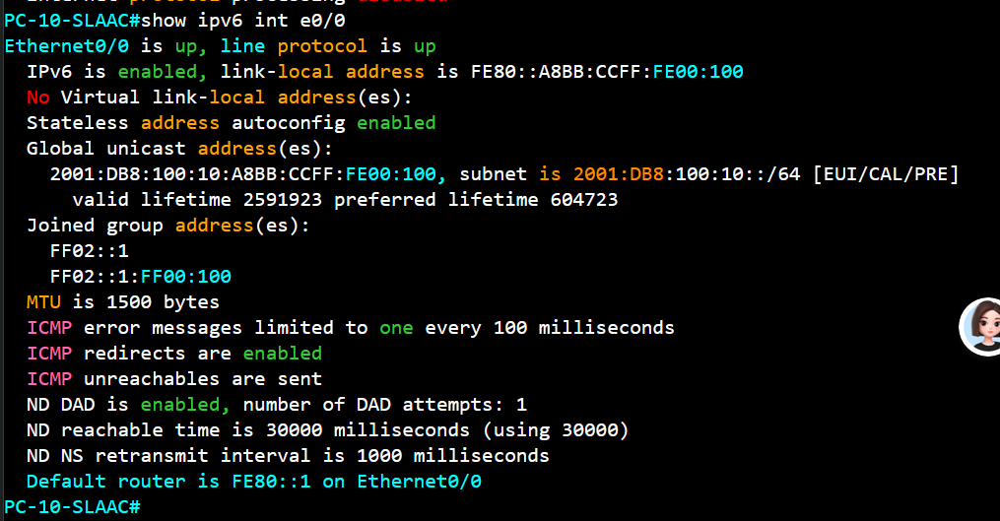
   PC-B
   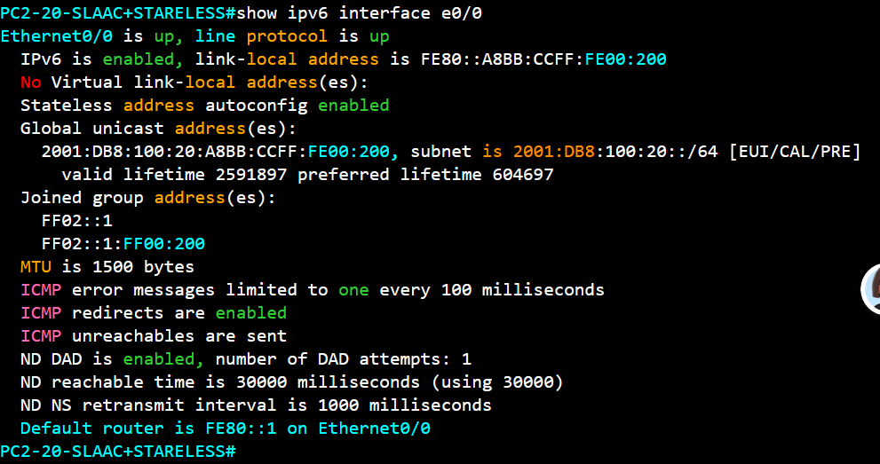
   PC-C
   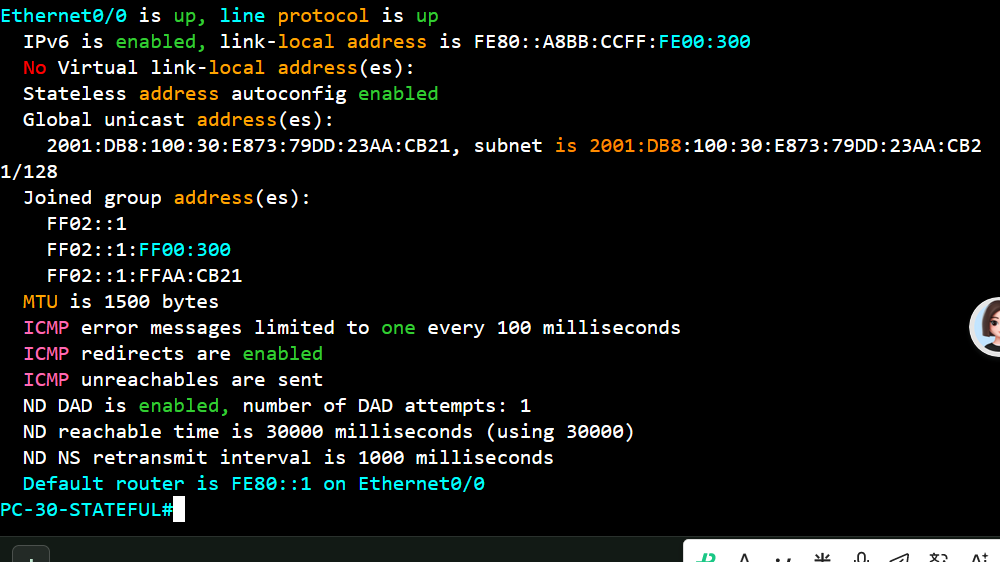
3. 请给出 R1 上 DHCPv6 Pool 和 DHCPv6 Binding 的验证截图  
   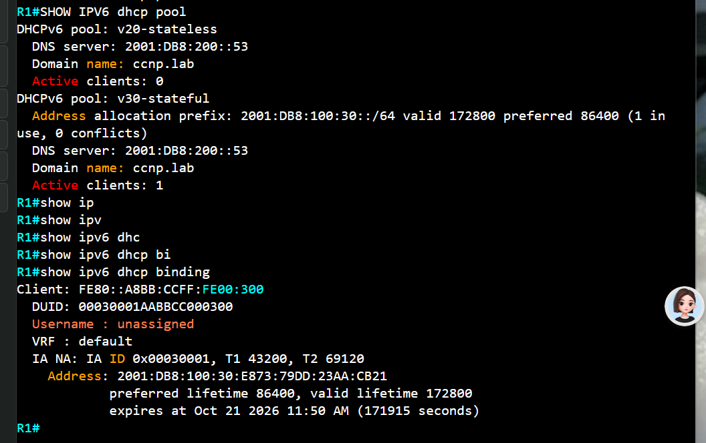

4. 请给出 R1、R2 的 IPv6 路由表验证截图  
   R1
   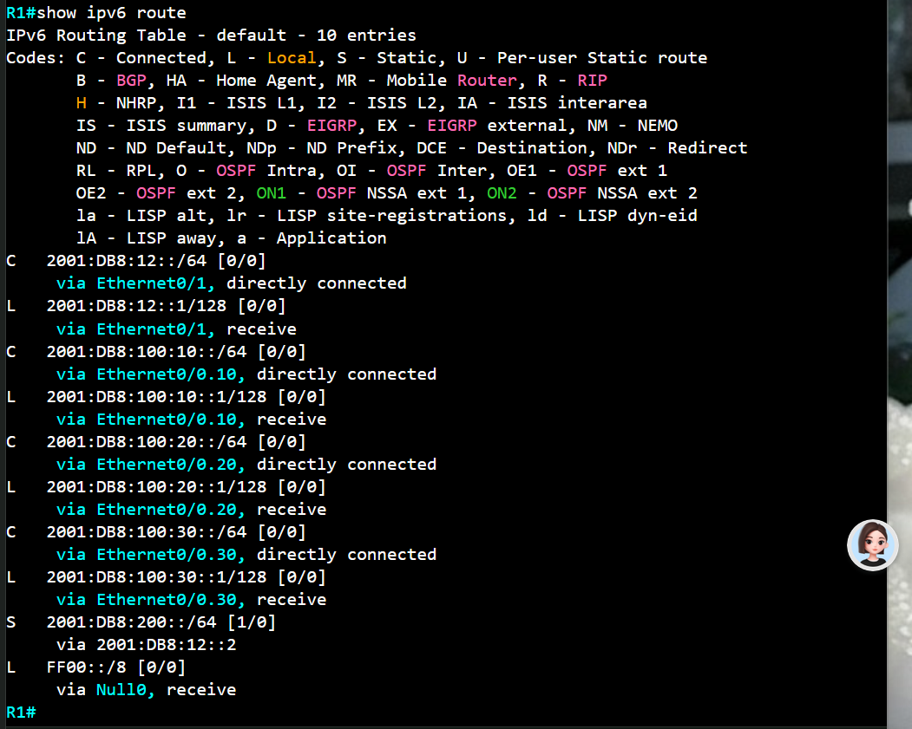
   R2
   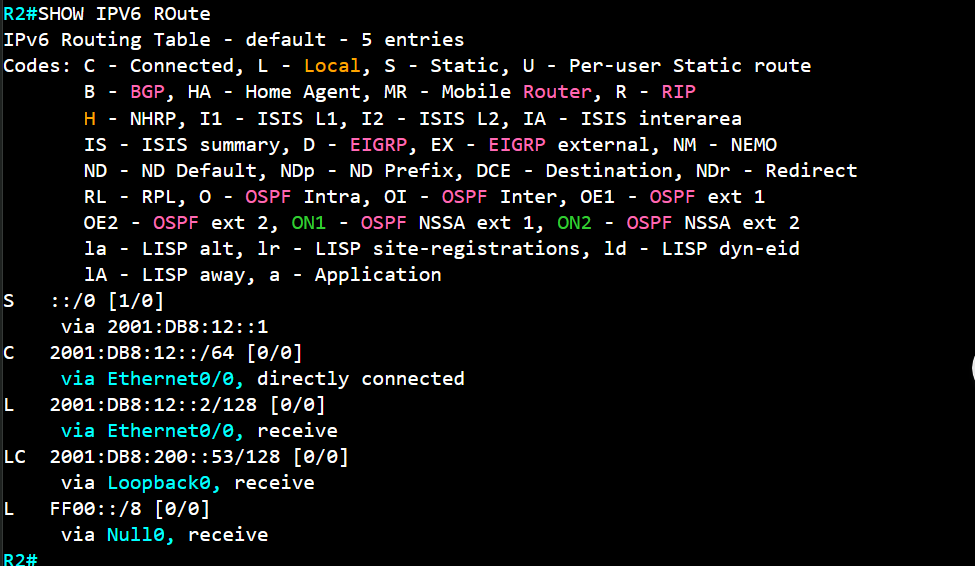
5. 请给出 PC-A、PC-B、PC-C ping `2001:db8:200::53` 成功的验证截图  
    PC-A
    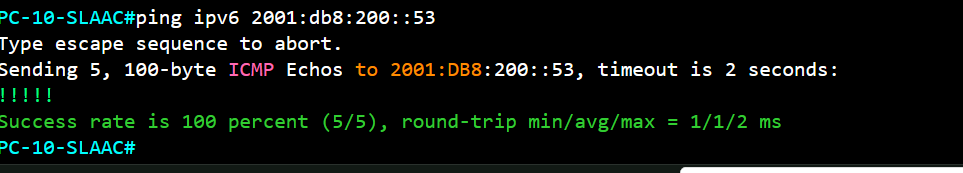
    PC-B
    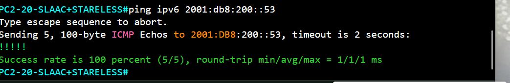
    PC-C
    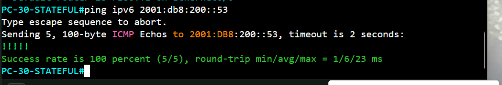
6. 请抓包或截图说明 PC-A 使用 SLAAC 时 RS、RA、DAD 报文的出现顺序  
   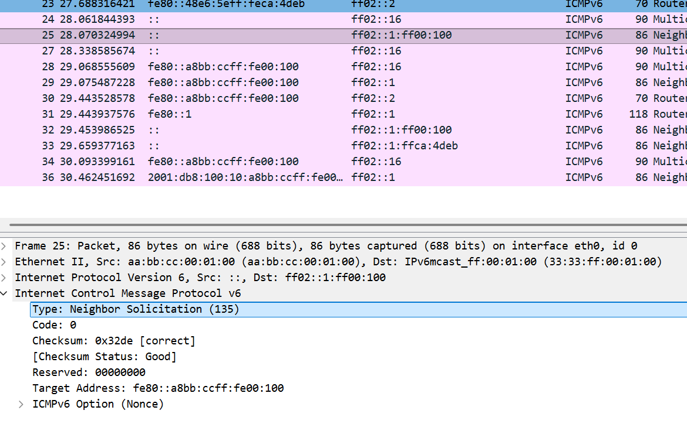
   主机 PC-A 生成Link-Local 地址并向组播地址ff02::1:ff00:100发送dad,确认链路本地地址可用
   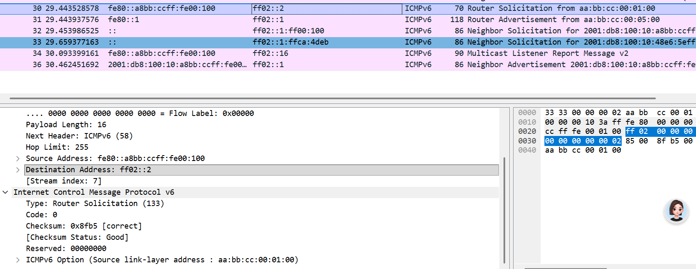
   主机用链路本地地址向路由器的广播地址fe02::2发送rs组播包
   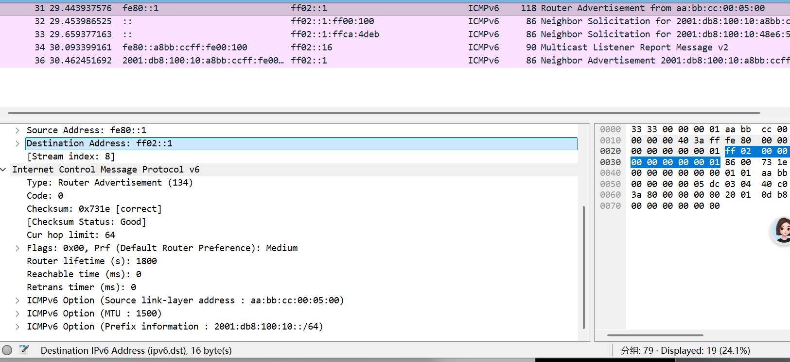
   路由器回包,并宣告前缀Prefix: 2001:db8:100:10::
7. 请抓包或截图说明 PC-B 使用 Stateless DHCPv6 时 RA 与 DHCPv6 报文的作用  
    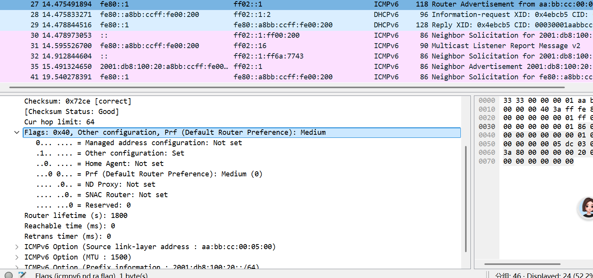
    ra报文A Flag =1 告知主机该前缀允许SLAA
    M Flag =0 不使用dhcpv6 获取地址
    O Flag =1 告知使用dhcpv6 获取其他信息
    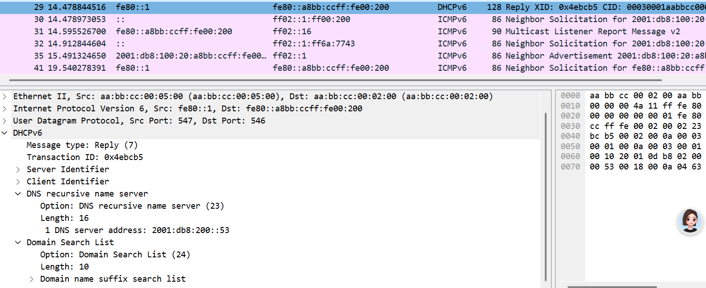
    dhcpv6告知dns地址和domain name
8. 请抓包或截图说明 PC-C 使用 Stateful DHCPv6 时地址分配过程  
    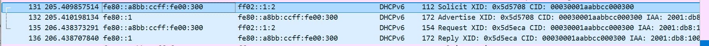
    四个包对应ipv4的dora
    首先通过ra报文的M Flag =1 使用dhcpv6 获取地址
    主机向fe02::1:2广播式问：“谁有能给我用的地址或参数？”
    有资源的服务器应答：“我能给你，这是候选地址”
    主机明确指定：“我选你（带 Server ID），请你正式分配”
    正式下发租约，其他服务器看到 Server ID 就知道自己没被选中
9.  请通过 PC-D 制造 IPv6 重复地址，并说明 DAD 失败的现象和原因  
    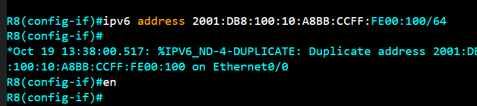
    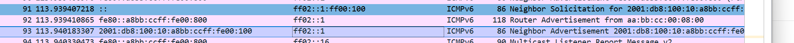
    pc4向申请地址的 Solicited-Node 组播，收到了pc1的na回复,所以失败

10.  请使用大包 ping 测试 PMTUD，并说明 ICMPv6 Packet Too Big 的触发原因
    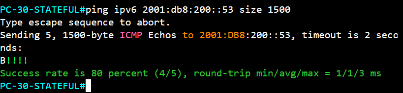
    R1-R2链路的IPv6 MTU被故意设置为==1280 ,从  PC-A发⼀个⼤于1280路径MTU的IPv6包到R2 Loopback,R1  会丢弃该包并返回Packet Too Big 
11.  请说明 IPv6 中为什么不使用 ARP，以及 NDP 中 NS、NA 分别承担什么作用
    arp它原有的一整套功能被重新设计并合并进了 ICMPv6/NDP,arp承载不了ipv6这么大的字段,arp使用广播,广播域的范围太大
    NS:地址解析,DAD 查重,NUD 探测
    NA:应答地址解析,应答 DAD,主动通告

12.  请说明 PC-A ping R2 Loopback0 的完整通信过程，包括默认网关获取、邻居发现、路由查表、Hop Limit 变化、二层封装变化与 Echo Reply 返回路径  
    
    ### 阶段 0：PC-A 拿到地址和默认网关（SLAAC）:
    1. R1 e0/0.10 起来后主动发 RA（Cisco 默认约 200s 周期，配置生效时会先发几次），目的地址 ff02::1（all-nodes），源地址=该子接口的链路本地地址 fe80::1。
    2. PC-A 收到 RA 后：2001:db8:10::/64 + EUI-64 接口 ID → 2001:DB8:100:10:A8BB:CCFF:FE00:100
    3. DAD：PC-A 从 :: 向该地址的 solicited-node 组播 ff02::1:ff66:6800（MAC 层 33:33:ff:66:68:00）发 1 个 NS（ipv6 nd dad attempts 默认 1）。收不到别人回的 NA → 约 1 秒后变 preferred，开始可用。
    4. 默认路由：PC-A 装 ::/0 → fe80::1，出接口 eth0。注意下一跳永远是链路本地地址，RA 不会给全局网关。
    
    ### 阶段 1：PC-A 查表 + 二层封装
    1. 路由查找（最长匹配）：2001:db8:200::53 不匹配 2001:db8:10::/64（on-link），命中 ::/0 → 下一跳 fe80::1，出 eth0。
    2. 构造 ICMPv6：Type 128（Echo Request）、Code 0、Identifier、Sequence；载荷 56B（VPCS 默认）。IPv6 首部 40B，Hop Limit = 64，源=PC-A 全局地址。
    3. 二层封装：dst MAC = R1 e0/0 的 MAC（不是 R2 的！），src MAC = PC-A，不打 VLAN tag（access 口发出的是无标签帧），EtherType 0x86DD。
    ### 阶段 2：R1 收包 → 转发（第 1 次 Hop Limit 递减）
    1. e0/0 收到带 tag 的帧，因为配了 interface e0/0.10 + encapsulation dot1Q 10，R1 剥掉 VID=10 的 tag 交给子接口 .10 处理。
    2. 目的 MAC = R1 e0/0 的 MAC → 交给 IPv6 处理；目的地址 2001:db8:200::53 不是本机地址 → 需要转发。
    3. 查 FIB（show ipv6 route 输出应为）：2001:db8:200::53/128 via 2001:db8:12::2（静态）或走默认/汇总路由 → 出 e0/1。
    4. Hop Limit 64 → 63（每台路由器转发减 1；若减到 0 就丢弃并回 ICMPv6 Type 3 Code 0 Time Exceeded）
    ### 阶段 3：R2 收到并产生 Echo Reply
    1. R2 e0/0 收到，目的 MAC 是自己 → 交给 IPv6；目的地址 2001:db8:200::53 命中 Lo0 的 local 表项 → 上送处理。
    2. 生成 ICMPv6 Type 129（Echo Reply），Code 0，Identifier/Sequence 原样回填，载荷同样 56B。
    3. 新包：源 2001:db8:200::53，目的 2001:db8:10::250:79ff:fe66:6800，Hop Limit = 64（重新置默认值）。
    ### 阶段 5：Echo Reply 返回路径
    1. R2 查表：目的 2001:db8:10::/64 没有直连 → 必须有回程路由（ipv6 route 2001:db8:10::/64 2001:db8:12::1 或 OSPFv3）。这是 90% “能通去程、不通回程/超时”的故障点：R2 上只写了 2001:db8:200::53/128 的静态路由而没有回程路由，ping 就会 100% 超时。
    2. R2 → R1：NS 解析 2001:db8:12::1（或直接命中缓存），帧 src=R2 e0/0 MAC、dst=R1 e0/1 MAC，HL 64。
    3. R1 收包：目的 2001:db8:10::… 是 .10 直连 → 命中 connected 路由，出 e0/0.10；HL 64 → 63。
    4. R1 加 tag：e0/0.10 出方向按 encapsulation dot1Q 10 把 VID=10 打进帧；目的 MAC 需要 PC-A 的——PC-A 地址在 .10 子网内，走 NS/NA（ff02::1:ff66:6800）后得到 PC-A MAC，缓存。
    5. SW1：入 e1/0 带 tag 10 → 查 MAC 表命中 e0/0（access VLAN 10）→ 剥掉 tag，无标签帧发往 PC-A。
    6. PC-A 收到：目的 MAC 自己、目的地址自己 → 匹配 Echo Reply 的 identifier/seq → 打印一行结果。VPCS 会显示 ttl=63（因为只经过 R1 一台路由器递减了一次）。
    
