# 7.CCNP Enterprise作业七——EIGRP 综合实验

## 作业主题

EIGRP 双栈综合实验：Classic/Legacy、Named Mode、认证、默认路由、汇总与非等价负载分担

## 作业目标

1. 掌握 IPv4 EIGRP Classic Mode 的基础配置与验证方法
2. 掌握 IPv6 EIGRP Legacy Mode 的基础配置与验证方法
3. 掌握 EIGRP Named Mode 中 IPv4/IPv6 Address Family 的配置结构
4. 掌握 EIGRP 认证、被动接口、Router ID、手工汇总和默认路由引入
5. 理解两个 EIGRP 域之间只通过默认路由互通、不互相引入明细路由的设计
6. 理解 `maximum-paths`、`variance` 与可行条件对 非等价负载分担的影响
7. 能使用 show 命令验证邻接、拓扑表、路由表、汇总路由和故障收敛

------

## 实验拓扑

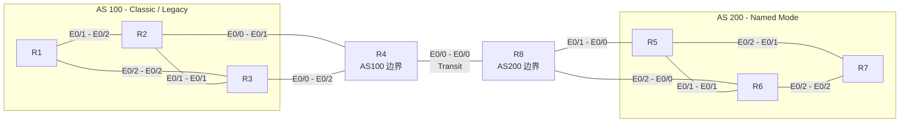

R4 只属于 AS100，R8 只属于 AS200。R4-R8 中间链路只作为普通三层 Transit 链路，不运行任何 EIGRP。

## 接口及 IP 地址规划

| 设备 | 接口 | 类型    | IPv4 规划      | IPv6 规划           |
| ---- | ---- | ------- | -------------- | ------------------- |
| R1   | E0/1 | AS100   | `10.1.12.1/24` | `2001:db8:12::1/64` |
| R1   | E0/2 | AS100   | `10.1.13.1/24` | `2001:db8:13::1/64` |
| R2   | E0/2 | AS100   | `10.1.12.2/24` | `2001:db8:12::2/64` |
| R2   | E0/1 | AS100   | `10.1.23.2/24` | `2001:db8:23::2/64` |
| R2   | E0/0 | AS100   | `10.1.24.2/24` | `2001:db8:24::2/64` |
| R3   | E0/2 | AS100   | `10.1.13.3/24` | `2001:db8:13::3/64` |
| R3   | E0/1 | AS100   | `10.1.23.3/24` | `2001:db8:23::3/64` |
| R3   | E0/0 | AS100   | `10.1.34.3/24` | `2001:db8:34::3/64` |
| R4   | E0/1 | AS100   | `10.1.24.4/24` | `2001:db8:24::4/64` |
| R4   | E0/2 | AS100   | `10.1.34.4/24` | `2001:db8:34::4/64` |
| R4   | E0/0 | Transit | `10.1.48.4/24` | `2001:db8:48::4/64` |
| R8   | E0/0 | Transit | `10.1.48.8/24` | `2001:db8:48::8/64` |
| R8   | E0/1 | AS200   | `10.1.58.8/24` | `2001:db8:58::8/64` |
| R8   | E0/2 | AS200   | `10.1.68.8/24` | `2001:db8:68::8/64` |
| R5   | E0/0 | AS200   | `10.1.58.5/24` | `2001:db8:58::5/64` |
| R5   | E0/1 | AS200   | `10.1.56.5/24` | `2001:db8:56::5/64` |
| R5   | E0/2 | AS200   | `10.1.57.5/24` | `2001:db8:57::5/64` |
| R6   | E0/0 | AS200   | `10.1.68.6/24` | `2001:db8:68::6/64` |
| R6   | E0/1 | AS200   | `10.1.56.6/24` | `2001:db8:56::6/64` |
| R6   | E0/2 | AS200   | `10.1.67.6/24` | `2001:db8:67::6/64` |
| R7   | E0/1 | AS200   | `10.1.57.7/24` | `2001:db8:57::7/64` |
| R7   | E0/2 | AS200   | `10.1.67.7/24` | `2001:db8:67::7/64` |

## Loopback 地址规划

| 设备 | Loopback   | 类型      | IPv4 规划        | IPv6 规划                |
| ---- | ---------- | --------- | ---------------- | ------------------------ |
| R1   | Loopback0  | Router ID | `1.1.1.1/32`     | `2001:db8:1:ffff::1/128` |
| R1   | Loopback10 | 业务网段  | `10.100.1.1/24`  | `2001:db8:100:1::1/64`   |
| R2   | Loopback0  | Router ID | `2.2.2.2/32`     | `2001:db8:2:ffff::2/128` |
| R2   | Loopback10 | 业务网段  | `10.100.2.2/24`  | `2001:db8:100:2::2/64`   |
| R3   | Loopback0  | Router ID | `3.3.3.3/32`     | `2001:db8:3:ffff::3/128` |
| R3   | Loopback10 | 业务网段  | `10.100.3.3/24`  | `2001:db8:100:3::3/64`   |
| R4   | Loopback0  | Router ID | `4.4.4.4/32`     | `2001:db8:4:ffff::4/128` |
| R8   | Loopback0  | Router ID | `8.8.8.8/32`     | `2001:db8:8:ffff::8/128` |
| R5   | Loopback0  | Router ID | `5.5.5.5/32`     | `2001:db8:5:ffff::5/128` |
| R5   | Loopback10 | 业务网段  | `10.200.5.5/24`  | `2001:db8:200:5::5/64`   |
| R6   | Loopback0  | Router ID | `6.6.6.6/32`     | `2001:db8:6:ffff::6/128` |
| R6   | Loopback10 | 业务网段  | `10.200.6.6/24`  | `2001:db8:200:6::6/64`   |
| R7   | Loopback0  | Router ID | `7.7.7.7/32`     | `2001:db8:7:ffff::7/128` |
| R7   | Loopback70 | 业务网段  | `10.200.70.7/24` | `2001:db8:200:70::7/64`  |
| R7   | Loopback71 | 业务网段  | `10.200.71.7/24` | `2001:db8:200:71::7/64`  |

## 接口连接规划

| 设备 | 接口 | 连接设备 | 连接接口 |
| ---- | ---- | -------- | -------- |
| R1   | E0/1 | R2       | E0/2     |
| R1   | E0/2 | R3       | E0/2     |
| R2   | E0/1 | R3       | E0/1     |
| R2   | E0/0 | R4       | E0/1     |
| R3   | E0/0 | R4       | E0/2     |
| R4   | E0/0 | R8       | E0/0     |
| R8   | E0/1 | R5       | E0/0     |
| R8   | E0/2 | R6       | E0/0     |
| R5   | E0/1 | R6       | E0/1     |
| R5   | E0/2 | R7       | E0/1     |
| R6   | E0/2 | R7       | E0/2     |

## EIGRP 域规划

| EIGRP 域 | 设备           | IPv4 模式    | IPv6 模式    | 说明             |
| -------- | -------------- | ------------ | ------------ | ---------------- |
| AS100    | R1、R2、R3、R4 | Classic Mode | Legacy EIGRP | R4 为 AS100 边界 |
| AS200    | R8、R5、R6、R7 | Named Mode   | Named Mode   | R8 为 AS200 边界 |
| Transit  | R4、R8         | 不运行 EIGRP | 不运行 EIGRP | 只配置三层地址   |

## 认证规划

| 位置                      | 地址族 | 认证方式     | Key-Chain / 密钥                 |
| ------------------------- | ------ | ------------ | -------------------------------- |
| AS100 所有 EIGRP 邻接接口 | IPv4   | MD5          | EIGRP-AS100-MD5 / CcnpAs100-2026 |
| AS100 所有 EIGRP 邻接接口 | IPv6   | MD5          | EIGRP-AS100-MD5 / CcnpAs100-2026 |
| AS200 所有 EIGRP 邻接接口 | IPv4   | MD5          | EIGRP-AS200-MD5 / CcnpAs200-2026 |
| AS200 所有 EIGRP 邻接接口 | IPv6   | HMAC-SHA-256 | CcnpAs200Sha-2026                |

## 默认路由规划

| 设备 | 静态默认路由                 | 引入位置       | 种子 Metric            |
| ---- | ---------------------------- | -------------- | ---------------------- |
| R4   | `0.0.0.0/0` 指向 `10.1.48.8` | EIGRP 100 IPv4 | `10000 100 255 1 1500` |
| R4   | `::/0` 指向 `2001:db8:48::8` | EIGRP 100 IPv6 | `10000 100 255 1 1500` |
| R8   | `0.0.0.0/0` 指向 `10.1.48.4` | AS200 IPv4 AF  | `10000 100 255 1 1500` |
| R8   | `::/0` 指向 `2001:db8:48::4` | AS200 IPv6 AF  | `10000 100 255 1 1500` |

本实验不允许配置 `redistribute eigrp 100` 或 `redistribute eigrp 200`，也不需要使用 prefix-list、route-map 或 distribute-list。R4、R8 上只引入本实验指定的静态默认路由。

## 汇总与负载分担规划

| 项目           | 配置位置         | 要求                                              |
| -------------- | ---------------- | ------------------------------------------------- |
| IPv4 汇总      | R7 的 E0/1、E0/2 | 向 R5、R6 发布 `10.200.0.0/16`                    |
| IPv6 汇总      | R7 的 E0/1、E0/2 | 向 R5、R6 发布 `2001:db8:200::/48`                |
| 非等价负载分担 | AS200            | `maximum-paths 4`，`variance 2`                   |
| Metric 调整    | R8 的 E0/2       | 只配置 `delay 200`，其他以太网接口保持默认 Metric |

------

## 配置需求

1. 根据实验拓扑完成设备连接与基础配置
2. 在所有路由器上开启 IPv6 单播转发
3. 按照规划表完成所有物理接口、Loopback 接口的 IPv4/IPv6 地址配置
4. 在 R1、R2、R3、R4 上配置 AS100 的 IPv4 EIGRP Classic Mode
5. 在 R1、R2、R3、R4 上配置 AS100 的 IPv6 EIGRP Legacy Mode
6. 在 AS100 中配置 Router ID、被动接口和传统接口认证
7. 在 R8、R5、R6、R7 上配置 AS200 的 EIGRP Named Mode
8. 在 AS200 中分别配置 IPv4 Address Family 与 IPv6 Address Family
9. 在 AS200 中配置 Router ID、被动接口、IPv4 MD5 认证和 IPv6 HMAC-SHA-256 认证
10. 确保 R4-R8 的 E0/0 Transit 链路不加入任何 EIGRP AS
11. 在 R4 上配置静态默认路由指向 R8，并将静态默认路由引入 AS100
12. 在 R8 上配置静态默认路由指向 R4，并将静态默认路由引入 AS200
13. 在 R7 面向 R5、R6 的接口上配置 IPv4/IPv6 手工汇总
14. 在 R8 的 E0/2 上配置 `delay 200`，用于观察非等价负载分担
15. 验证 AS100 与 AS200 内部邻接、拓扑表和路由表是否正常
16. 验证 AS100 与 AS200 只通过默认路由跨域通信，不互相学习对方业务明细路由
17. 验证关闭指定链路后的 EIGRP 收敛现象

------

## 验证要求

1. 使用 `show ip eigrp neighbors` 和 `show ipv6 eigrp neighbors` 验证 AS100 邻接
2. 使用 `show eigrp address-family ipv4 neighbors` 和 `show eigrp address-family ipv6 neighbors` 验证 AS200 邻接
3. 使用 `show ip protocols` 或 `show eigrp protocols` 验证 Router ID、Network、Passive、Maximum Paths 和 Variance
4. 在 R1、R7 上验证是否学习到 EIGRP 默认路由
5. 在 R1 上验证不应学习到 AS200 的 `10.200.0.0/16` 或其他 AS200 明细为 `D EX`
6. 在 R7 上验证不应学习到 AS100 的 `10.100.0.0/16` 或其他 AS100 明细为 `D EX`
7. 从 R1 的业务 Loopback ping R7 的业务 Loopback，验证 IPv4/IPv6 跨域连通性
8. 在 R8 上查看到 R7 汇总网段的拓扑信息，观察多候选路径与 `variance 2` 的效果
9. 关闭 R8 到 R5 的链路，观察 AS200 内部重新收敛
10. 关闭 R4 到 R2 的链路，观察 AS100 内部重新收敛
11. 关闭 R4-R8 Transit 链路，验证该链路故障不会导致 EIGRP 邻接变化，但会影响跨域业务通信

------

## 作业要求

1. 请提交 R1、R2、R3、R4、R5、R6、R7、R8 的最终配置
```

!
! Last configuration change at 08:50:42 UTC Wed Nov 4 2026
!
version 15.7
service timestamps debug datetime msec
service timestamps log datetime msec
no service password-encryption
!
hostname R1
!
boot-start-marker
boot-end-marker
!
!
!
no aaa new-model
!
!
!
mmi polling-interval 60
no mmi auto-configure
no mmi pvc
mmi snmp-timeout 180
!
!
!
!
!
!
!
!
!
!
!
!
!
!
!


!
!
!
!
no ip domain lookup
ip cef
ipv6 unicast-routing
ipv6 cef
!
multilink bundle-name authenticated
!
!
!
key chain EIGRP-AS100-MD5
 key 1
  key-string CcnpAs100-2026
!
!
!
!
!
!
!
!
redundancy
!
!
! 
!
!
!
!
!
!
!
!
!
!
!
!
interface Loopback0
 no shutdown
 ip address 1.1.1.1 255.255.255.255
 ipv6 address 2001:DB8:1:FFFF::1/128
 ipv6 eigrp 100
!
interface Loopback10
 no shutdown
 ip address 10.100.1.1 255.255.255.0
 ipv6 address 2001:DB8:100:1::1/64
 ipv6 eigrp 100
!
interface Ethernet0/0
 no shutdown
 no ip address
 shutdown
 duplex auto
!
interface Ethernet0/1
 no shutdown
 ip address 10.1.12.1 255.255.255.0
 ip authentication mode eigrp 100 md5
 ip authentication key-chain eigrp 100 EIGRP-AS100-MD5
 duplex auto
 ipv6 address 2001:DB8:12::1/64
 ipv6 eigrp 100
 ipv6 authentication mode eigrp 100 md5
 ipv6 authentication key-chain eigrp 100 EIGRP-AS100-MD5
!
interface Ethernet0/2
 no shutdown
 ip address 10.1.13.1 255.255.255.0
 ip authentication mode eigrp 100 md5
 ip authentication key-chain eigrp 100 EIGRP-AS100-MD5
 duplex auto
 ipv6 address 2001:DB8:13::1/64
 ipv6 eigrp 100
 ipv6 authentication mode eigrp 100 md5
 ipv6 authentication key-chain eigrp 100 EIGRP-AS100-MD5
!
interface Ethernet0/3
 no shutdown
 no ip address
 shutdown
 duplex auto
!
interface Ethernet1/0
 no shutdown
 no ip address
 shutdown
 duplex auto
!
interface Ethernet1/1
 no shutdown
 no ip address
 shutdown
 duplex auto
!
interface Ethernet1/2
 no shutdown
 no ip address
 shutdown
 duplex auto
!
interface Ethernet1/3
 no shutdown
 no ip address
 shutdown
 duplex auto
!
interface Ethernet2/0
 no shutdown
 no ip address
 shutdown
 duplex auto
!
interface Ethernet2/1
 no shutdown
 no ip address
 shutdown
 duplex auto
!
interface Ethernet2/2
 no shutdown
 no ip address
 shutdown
 duplex auto
!
interface Ethernet2/3
 no shutdown
 no ip address
 shutdown
 duplex auto
!
interface Ethernet3/0
 no shutdown
 no ip address
 shutdown
 duplex auto
!
interface Ethernet3/1
 no shutdown
 no ip address
 shutdown
 duplex auto
!
interface Ethernet3/2
 no shutdown
 no ip address
 shutdown
 duplex auto
!
interface Ethernet3/3
 no shutdown
 no ip address
 shutdown
 duplex auto
!
!
router eigrp 100
 network 1.1.1.1 0.0.0.0
 network 10.1.12.0 0.0.0.255
 network 10.1.13.0 0.0.0.255
 network 10.100.1.0 0.0.0.255
 passive-interface default
 no passive-interface Ethernet0/1
 no passive-interface Ethernet0/2
 eigrp router-id 1.1.1.1
!
ip forward-protocol nd
!
!
no ip http server
no ip http secure-server
!
ipv6 router eigrp 100
 passive-interface default
 no passive-interface Ethernet0/1
 no passive-interface Ethernet0/2
 no passive-interface Loopback0
 no passive-interface Loopback10
 eigrp router-id 1.1.1.1
!
ipv6 ioam timestamp
!
!
!
control-plane
!
!
!
!
!
!
!
!
line con 0
 logging synchronous
line aux 0
line vty 0 4
 login
 transport input none
!
!
end
```  
r2
```

!
! Last configuration change at 08:41:19 UTC Wed Nov 4 2026
!
version 15.7
service timestamps debug datetime msec
service timestamps log datetime msec
no service password-encryption
!
hostname R2
!
boot-start-marker
boot-end-marker
!
!
!
no aaa new-model
!
!
!
mmi polling-interval 60
no mmi auto-configure
no mmi pvc
mmi snmp-timeout 180
!
!
!
!
!
!
!
!
!
!
!
!
!
!
!


!
!
!
!
no ip domain lookup
ip cef
ipv6 unicast-routing
ipv6 cef
!
multilink bundle-name authenticated
!
!
!
key chain EIGRP-AS100-MD5
 key 1
  key-string CcnpAs100-2026
!
!
!
!
!
!
!
!
redundancy
!
!
! 
!
!
!
!
!
!
!
!
!
!
!
!
interface Loopback0
 no shutdown
 ip address 2.2.2.2 255.255.255.255
 ipv6 address 2001:DB8:2:FFFF::2/128
 ipv6 eigrp 100
!
interface Loopback10
 no shutdown
 ip address 10.100.2.2 255.255.255.0
 ipv6 address 2001:DB8:100:2::2/64
 ipv6 eigrp 100
!
interface Ethernet0/0
 no shutdown
 ip address 10.1.24.2 255.255.255.0
 ip authentication mode eigrp 100 md5
 ip authentication key-chain eigrp 100 EIGRP-AS100-MD5
 duplex auto
 ipv6 address 2001:DB8:24::2/64
 ipv6 eigrp 100
 ipv6 authentication mode eigrp 100 md5
 ipv6 authentication key-chain eigrp 100 EIGRP-AS100-MD5
!
interface Ethernet0/1
 no shutdown
 ip address 10.1.23.2 255.255.255.0
 ip authentication mode eigrp 100 md5
 ip authentication key-chain eigrp 100 EIGRP-AS100-MD5
 duplex auto
 ipv6 address 2001:DB8:23::2/64
 ipv6 eigrp 100
 ipv6 authentication mode eigrp 100 md5
 ipv6 authentication key-chain eigrp 100 EIGRP-AS100-MD5
!
interface Ethernet0/2
 no shutdown
 ip address 10.1.12.2 255.255.255.0
 ip authentication mode eigrp 100 md5
 ip authentication key-chain eigrp 100 EIGRP-AS100-MD5
 duplex auto
 ipv6 address 2001:DB8:12::2/64
 ipv6 eigrp 100
 ipv6 authentication mode eigrp 100 md5
 ipv6 authentication key-chain eigrp 100 EIGRP-AS100-MD5
!
interface Ethernet0/3
 no shutdown
 no ip address
 shutdown
 duplex auto
!
interface Ethernet1/0
 no shutdown
 no ip address
 shutdown
 duplex auto
!
interface Ethernet1/1
 no shutdown
 no ip address
 shutdown
 duplex auto
!
interface Ethernet1/2
 no shutdown
 no ip address
 shutdown
 duplex auto
!
interface Ethernet1/3
 no shutdown
 no ip address
 shutdown
 duplex auto
!
interface Ethernet2/0
 no shutdown
 no ip address
 shutdown
 duplex auto
!
interface Ethernet2/1
 no shutdown
 no ip address
 shutdown
 duplex auto
!
interface Ethernet2/2
 no shutdown
 no ip address
 shutdown
 duplex auto
!
interface Ethernet2/3
 no shutdown
 no ip address
 shutdown
 duplex auto
!
interface Ethernet3/0
 no shutdown
 no ip address
 shutdown
 duplex auto
!
interface Ethernet3/1
 no shutdown
 no ip address
 shutdown
 duplex auto
!
interface Ethernet3/2
 no shutdown
 no ip address
 shutdown
 duplex auto
!
interface Ethernet3/3
 no shutdown
 no ip address
 shutdown
 duplex auto
!
!
router eigrp 100
 network 2.2.2.2 0.0.0.0
 network 10.1.12.0 0.0.0.255
 network 10.1.23.0 0.0.0.255
 network 10.1.24.0 0.0.0.255
 network 10.100.2.0 0.0.0.255
 passive-interface default
 no passive-interface Ethernet0/0
 no passive-interface Ethernet0/1
 no passive-interface Ethernet0/2
 eigrp router-id 2.2.2.2
!
ip forward-protocol nd
!
!
no ip http server
no ip http secure-server
!
ipv6 router eigrp 100
 passive-interface default
 no passive-interface Ethernet0/0
 no passive-interface Ethernet0/1
 no passive-interface Ethernet0/2
 no passive-interface Loopback0
 no passive-interface Loopback10
 eigrp router-id 2.2.2.2
!
ipv6 ioam timestamp
!
!
!
control-plane
!
!
!
!
!
!
!
!
line con 0
 logging synchronous
line aux 0
line vty 0 4
 login
 transport input none
!
!
end

```

r3
```

!
! Last configuration change at 08:44:12 UTC Wed Nov 4 2026
!
version 15.7
service timestamps debug datetime msec
service timestamps log datetime msec
no service password-encryption
!
hostname R3
!
boot-start-marker
boot-end-marker
!
!
!
no aaa new-model
!
!
!
mmi polling-interval 60
no mmi auto-configure
no mmi pvc
mmi snmp-timeout 180
!
!
!
!
!
!
!
!
!
!
!
!
!
!
!


!
!
!
!
no ip domain lookup
ip cef
ipv6 unicast-routing
ipv6 cef
!
multilink bundle-name authenticated
!
!
!
key chain EIGRP-AS100-MD5
 key 1
  key-string CcnpAs100-2026
!
!
!
!
!
!
!
!
redundancy
!
!
! 
!
!
!
!
!
!
!
!
!
!
!
!
interface Loopback0
 no shutdown
 ip address 3.3.3.3 255.255.255.255
 ipv6 address 2001:DB8:3:FFFF::3/128
 ipv6 eigrp 100
!
interface Loopback10
 no shutdown
 ip address 10.100.3.3 255.255.255.0
 ipv6 address 2001:DB8:100:3::3/64
 ipv6 eigrp 100
!
interface Ethernet0/0
 no shutdown
 ip address 10.1.34.3 255.255.255.0
 ip authentication mode eigrp 100 md5
 ip authentication key-chain eigrp 100 EIGRP-AS100-MD5
 duplex auto
 ipv6 address 2001:DB8:34::3/64
 ipv6 eigrp 100
 ipv6 authentication mode eigrp 100 md5
 ipv6 authentication key-chain eigrp 100 EIGRP-AS100-MD5
!
interface Ethernet0/1
 no shutdown
 ip address 10.1.23.3 255.255.255.0
 ip authentication mode eigrp 100 md5
 ip authentication key-chain eigrp 100 EIGRP-AS100-MD5
 duplex auto
 ipv6 address 2001:DB8:23::3/64
 ipv6 eigrp 100
 ipv6 authentication mode eigrp 100 md5
 ipv6 authentication key-chain eigrp 100 EIGRP-AS100-MD5
!
interface Ethernet0/2
 no shutdown
 ip address 10.1.13.3 255.255.255.0
 ip authentication mode eigrp 100 md5
 ip authentication key-chain eigrp 100 EIGRP-AS100-MD5
 duplex auto
 ipv6 address 2001:DB8:13::3/64
 ipv6 eigrp 100
 ipv6 authentication mode eigrp 100 md5
 ipv6 authentication key-chain eigrp 100 EIGRP-AS100-MD5
!
interface Ethernet0/3
 no shutdown
 no ip address
 shutdown
 duplex auto
!
interface Ethernet1/0
 no shutdown
 no ip address
 shutdown
 duplex auto
!
interface Ethernet1/1
 no shutdown
 no ip address
 shutdown
 duplex auto
!
interface Ethernet1/2
 no shutdown
 no ip address
 shutdown
 duplex auto
!
interface Ethernet1/3
 no shutdown
 no ip address
 shutdown
 duplex auto
!
interface Ethernet2/0
 no shutdown
 no ip address
 shutdown
 duplex auto
!
interface Ethernet2/1
 no shutdown
 no ip address
 shutdown
 duplex auto
!
interface Ethernet2/2
 no shutdown
 no ip address
 shutdown
 duplex auto
!
interface Ethernet2/3
 no shutdown
 no ip address
 shutdown
 duplex auto
!
interface Ethernet3/0
 no shutdown
 no ip address
 shutdown
 duplex auto
!
interface Ethernet3/1
 no shutdown
 no ip address
 shutdown
 duplex auto
!
interface Ethernet3/2
 no shutdown
 no ip address
 shutdown
 duplex auto
!
interface Ethernet3/3
 no shutdown
 no ip address
 shutdown
 duplex auto
!
!
router eigrp 100
 network 3.3.3.3 0.0.0.0
 network 10.1.13.0 0.0.0.255
 network 10.1.23.0 0.0.0.255
 network 10.1.34.0 0.0.0.255
 network 10.100.3.0 0.0.0.255
 passive-interface default
 no passive-interface Ethernet0/0
 no passive-interface Ethernet0/1
 no passive-interface Ethernet0/2
 eigrp router-id 3.3.3.3
!
ip forward-protocol nd
!
!
no ip http server
no ip http secure-server
!
ipv6 router eigrp 100
 passive-interface default
 no passive-interface Ethernet0/0
 no passive-interface Ethernet0/1
 no passive-interface Ethernet0/2
 eigrp router-id 3.3.3.3
!
ipv6 ioam timestamp
!
!
!
control-plane
!
!
!
!
!
!
!
!
line con 0
 logging synchronous
line aux 0
line vty 0 4
 login
 transport input none
!
!
end

```
r4
```

!
! Last configuration change at 13:00:04 UTC Wed Nov 4 2026
!
version 15.7
service timestamps debug datetime msec
service timestamps log datetime msec
no service password-encryption
!
hostname R4
!
boot-start-marker
boot-end-marker
!
!
!
no aaa new-model
!
!
!
mmi polling-interval 60
no mmi auto-configure
no mmi pvc
mmi snmp-timeout 180
!
!
!
!
!
!
!
!
!
!
!
!
!
!
!


!
!
!
!
no ip domain lookup
ip cef
ipv6 unicast-routing
ipv6 cef
!
multilink bundle-name authenticated
!
!
!
key chain EIGRP-AS100-MD5
 key 1
  key-string CcnpAs100-2026
!
!
!
!
!
!
!
!
redundancy
!
!
! 
!
!
!
!
!
!
!
!
!
!
!
!
interface Loopback0
 no shutdown
 ip address 4.4.4.4 255.255.255.255
 ipv6 address 2001:DB8:4:FFFF::4/128
 ipv6 eigrp 100
!
interface Ethernet0/0
 no shutdown
 ip address 10.1.48.4 255.255.255.0
 duplex auto
 ipv6 address 2001:DB8:48::4/64
!
interface Ethernet0/1
 no shutdown
 ip address 10.1.24.4 255.255.255.0
 ip authentication mode eigrp 100 md5
 ip authentication key-chain eigrp 100 EIGRP-AS100-MD5
 duplex auto
 ipv6 address 2001:DB8:24::4/64
 ipv6 eigrp 100
 ipv6 authentication mode eigrp 100 md5
 ipv6 authentication key-chain eigrp 100 EIGRP-AS100-MD5
!
interface Ethernet0/2
 no shutdown
 ip address 10.1.34.4 255.255.255.0
 ip authentication mode eigrp 100 md5
 ip authentication key-chain eigrp 100 EIGRP-AS100-MD5
 duplex auto
 ipv6 address 2001:DB8:34::4/64
 ipv6 eigrp 100
 ipv6 authentication mode eigrp 100 md5
 ipv6 authentication key-chain eigrp 100 EIGRP-AS100-MD5
!
interface Ethernet0/3
 no shutdown
 no ip address
 shutdown
 duplex auto
!
interface Ethernet1/0
 no shutdown
 no ip address
 shutdown
 duplex auto
!
interface Ethernet1/1
 no shutdown
 no ip address
 shutdown
 duplex auto
!
interface Ethernet1/2
 no shutdown
 no ip address
 shutdown
 duplex auto
!
interface Ethernet1/3
 no shutdown
 no ip address
 shutdown
 duplex auto
!
interface Ethernet2/0
 no shutdown
 no ip address
 shutdown
 duplex auto
!
interface Ethernet2/1
 no shutdown
 no ip address
 shutdown
 duplex auto
!
interface Ethernet2/2
 no shutdown
 no ip address
 shutdown
 duplex auto
!
interface Ethernet2/3
 no shutdown
 no ip address
 shutdown
 duplex auto
!
interface Ethernet3/0
 no shutdown
 no ip address
 shutdown
 duplex auto
!
interface Ethernet3/1
 no shutdown
 no ip address
 shutdown
 duplex auto
!
interface Ethernet3/2
 no shutdown
 no ip address
 shutdown
 duplex auto
!
interface Ethernet3/3
 no shutdown
 no ip address
 shutdown
 duplex auto
!
!
router eigrp 100
 network 4.4.4.4 0.0.0.0
 network 10.1.24.0 0.0.0.255
 network 10.1.34.0 0.0.0.255
 redistribute static metric 10000 100 255 1 1500
 passive-interface default
 no passive-interface Ethernet0/1
 no passive-interface Ethernet0/2
 eigrp router-id 4.4.4.4
!
ip forward-protocol nd
!
!
no ip http server
no ip http secure-server
ip route 0.0.0.0 0.0.0.0 10.1.48.8
!
ipv6 route ::/0 2001:DB8:48::8
ipv6 router eigrp 100
 passive-interface default
 no passive-interface Ethernet0/1
 no passive-interface Ethernet0/2
 eigrp router-id 4.4.4.4
 redistribute static metric 10000 100 255 1 1500
!
ipv6 ioam timestamp
!
!
!
control-plane
!
!
!
!
!
!
!
!
line con 0
 logging synchronous
line aux 0
line vty 0 4
 login
 transport input none
!
!
end

```
r5
```


!
! Last configuration change at 12:12:06 UTC Wed Nov 4 2026
!
version 15.7
service timestamps debug datetime msec
service timestamps log datetime msec
no service password-encryption
!
hostname R5
!
boot-start-marker
boot-end-marker
!
!
!
no aaa new-model
!
!
!
mmi polling-interval 60
no mmi auto-configure
no mmi pvc
mmi snmp-timeout 180
!
!
!
!
!
!
!
!
!
!
!
!
!
!
!


!
!
!
!
no ip domain lookup
ip cef
ipv6 unicast-routing
ipv6 cef
!
multilink bundle-name authenticated
!
!
!
key chain EIGRP-AS200-MD5
 key 1
  key-string CcnpAs200-2026
!
!
!
!
!
!
!
!
redundancy
!
!
! 
!
!
!
!
!
!
!
!
!
!
!
!
interface Loopback0
 no shutdown
 ip address 5.5.5.5 255.255.255.255
 ipv6 address 2001:DB8:5:FFFF::5/128
!
interface Loopback10
 no shutdown
 ip address 10.200.5.5 255.255.255.0
 ipv6 address 2001:DB8:200:5::5/64
!
interface Ethernet0/0
 no shutdown
 ip address 10.1.58.5 255.255.255.0
 duplex auto
 ipv6 address 2001:DB8:58::5/64
!
interface Ethernet0/1
 no shutdown
 ip address 10.1.56.5 255.255.255.0
 duplex auto
 ipv6 address 2001:DB8:56::5/64
!
interface Ethernet0/2
 no shutdown
 ip address 10.1.57.5 255.255.255.0
 duplex auto
 ipv6 address 2001:DB8:57::5/64
!
interface Ethernet0/3
 no shutdown
 no ip address
 shutdown
 duplex auto
!
interface Ethernet1/0
 no shutdown
 no ip address
 shutdown
 duplex auto
!
interface Ethernet1/1
 no shutdown
 no ip address
 shutdown
 duplex auto
!
interface Ethernet1/2
 no shutdown
 no ip address
 shutdown
 duplex auto
!
interface Ethernet1/3
 no shutdown
 no ip address
 shutdown
 duplex auto
!
interface Ethernet2/0
 no shutdown
 no ip address
 shutdown
 duplex auto
!
interface Ethernet2/1
 no shutdown
 no ip address
 shutdown
 duplex auto
!
interface Ethernet2/2
 no shutdown
 no ip address
 shutdown
 duplex auto
!
interface Ethernet2/3
 no shutdown
 no ip address
 shutdown
 duplex auto
!
interface Ethernet3/0
 no shutdown
 no ip address
 shutdown
 duplex auto
!
interface Ethernet3/1
 no shutdown
 no ip address
 shutdown
 duplex auto
!
interface Ethernet3/2
 no shutdown
 no ip address
 shutdown
 duplex auto
!
interface Ethernet3/3
 no shutdown
 no ip address
 shutdown
 duplex auto
!
!
router eigrp AS200
 !
 address-family ipv4 unicast autonomous-system 200
  !
  af-interface default
   authentication mode md5
   authentication key-chain EIGRP-AS200-MD5
   passive-interface
  exit-af-interface
  !
  af-interface Ethernet0/1
   no passive-interface
  exit-af-interface
  !
  af-interface Ethernet0/0
   no passive-interface
  exit-af-interface
  !
  af-interface Ethernet0/2
   no passive-interface
  exit-af-interface
  !
  topology base
   variance 2
  exit-af-topology
  network 5.5.5.5 0.0.0.0
  network 10.1.56.0 0.0.0.255
  network 10.1.57.0 0.0.0.255
  network 10.1.58.0 0.0.0.255
  network 10.200.5.0 0.0.0.255
  eigrp router-id 5.5.5.5
 exit-address-family
 !
 address-family ipv6 unicast autonomous-system 200
  !
  af-interface default
   authentication mode hmac-sha-256 CcnpAs200Sha-2026
   passive-interface
  exit-af-interface
  !
  af-interface Ethernet0/0
   no passive-interface
  exit-af-interface
  !
  af-interface Ethernet0/1
   no passive-interface
  exit-af-interface
  !
  af-interface Ethernet0/2
   no passive-interface
  exit-af-interface
  !
  topology base
   maximum-paths 4
   variance 2
  exit-af-topology
  eigrp router-id 5.5.5.5
 exit-address-family
!
ip forward-protocol nd
!
!
no ip http server
no ip http secure-server
!
ipv6 ioam timestamp
!
!
!
control-plane
!
!
!
!
!
!
!
!
line con 0
 logging synchronous
line aux 0
line vty 0 4
 login
 transport input none
!
!
end

```
r6
```

!
! Last configuration change at 12:02:54 UTC Wed Nov 4 2026
!
version 15.7
service timestamps debug datetime msec
service timestamps log datetime msec
no service password-encryption
!
hostname R6
!
boot-start-marker
boot-end-marker
!
!
!
no aaa new-model
!
!
!
mmi polling-interval 60
no mmi auto-configure
no mmi pvc
mmi snmp-timeout 180
!
!
!
!
!
!
!
!
!
!
!
!
!
!
!


!
!
!
!
no ip domain lookup
ip cef
ipv6 unicast-routing
ipv6 cef
!
multilink bundle-name authenticated
!
!
!
key chain EIGRP-AS200-MD5
 key 1
  key-string CcnpAs200-2026
!
!
!
!
!
!
!
!
redundancy
!
!
! 
!
!
!
!
!
!
!
!
!
!
!
!
interface Loopback0
 no shutdown
 ip address 6.6.6.6 255.255.255.255
 ipv6 address 2001:DB8:6:FFFF::6/128
!
interface Loopback10
 no shutdown
 ip address 10.200.6.6 255.255.255.0
 ipv6 address 2001:DB8:200:6::6/64
!
interface Ethernet0/0
 no shutdown
 ip address 10.1.68.6 255.255.255.0
 duplex auto
 ipv6 address 2001:DB8:68::6/64
!
interface Ethernet0/1
 no shutdown
 ip address 10.1.56.6 255.255.255.0
 duplex auto
 ipv6 address 2001:DB8:56::6/64
!
interface Ethernet0/2
 no shutdown
 ip address 10.1.67.6 255.255.255.0
 duplex auto
 ipv6 address 2001:DB8:67::6/64
!
interface Ethernet0/3
 no shutdown
 no ip address
 shutdown
 duplex auto
!
interface Ethernet1/0
 no shutdown
 no ip address
 shutdown
 duplex auto
!
interface Ethernet1/1
 no shutdown
 no ip address
 shutdown
 duplex auto
!
interface Ethernet1/2
 no shutdown
 no ip address
 shutdown
 duplex auto
!
interface Ethernet1/3
 no shutdown
 no ip address
 shutdown
 duplex auto
!
interface Ethernet2/0
 no shutdown
 no ip address
 shutdown
 duplex auto
!
interface Ethernet2/1
 no shutdown
 no ip address
 shutdown
 duplex auto
!
interface Ethernet2/2
 no shutdown
 no ip address
 shutdown
 duplex auto
!
interface Ethernet2/3
 no shutdown
 no ip address
 shutdown
 duplex auto
!
interface Ethernet3/0
 no shutdown
 no ip address
 shutdown
 duplex auto
!
interface Ethernet3/1
 no shutdown
 no ip address
 shutdown
 duplex auto
!
interface Ethernet3/2
 no shutdown
 no ip address
 shutdown
 duplex auto
!
interface Ethernet3/3
 no shutdown
 no ip address
 shutdown
 duplex auto
!
!
router eigrp AS200
 !
 address-family ipv4 unicast autonomous-system 200
  !
  af-interface default
   authentication mode md5
   authentication key-chain EIGRP-AS200-MD5
   passive-interface
  exit-af-interface
  !
  af-interface Ethernet0/0
   no passive-interface
  exit-af-interface
  !
  af-interface Ethernet0/1
   no passive-interface
  exit-af-interface
  !
  af-interface Ethernet0/2
   no passive-interface
  exit-af-interface
  !
  topology base
   variance 2
  exit-af-topology
  network 6.6.6.6 0.0.0.0
  network 10.1.56.0 0.0.0.255
  network 10.1.67.0 0.0.0.255
  network 10.1.68.0 0.0.0.255
  network 10.200.6.0 0.0.0.255
  eigrp router-id 6.6.6.6
 exit-address-family
 !
 address-family ipv6 unicast autonomous-system 200
  !
  af-interface default
   authentication mode hmac-sha-256 CcnpAs200Sha-2026
   passive-interface
  exit-af-interface
  !
  af-interface Ethernet0/0
   no passive-interface
  exit-af-interface
  !
  af-interface Ethernet0/1
   no passive-interface
  exit-af-interface
  !
  af-interface Ethernet0/2
   no passive-interface
  exit-af-interface
  !
  topology base
   maximum-paths 4
   variance 2
  exit-af-topology
  eigrp router-id 6.6.6.6
 exit-address-family
!
ip forward-protocol nd
!
!
no ip http server
no ip http secure-server
!
ipv6 ioam timestamp
!
!
!
control-plane
!
!
!
!
!
!
!
!
line con 0
 logging synchronous
line aux 0
line vty 0 4
 login
 transport input none
!
!
end

```
r7
```

!
! Last configuration change at 12:48:30 UTC Wed Nov 4 2026
!
version 15.7
service timestamps debug datetime msec
service timestamps log datetime msec
no service password-encryption
!
hostname R7
!
boot-start-marker
boot-end-marker
!
!
!
no aaa new-model
!
!
!
mmi polling-interval 60
no mmi auto-configure
no mmi pvc
mmi snmp-timeout 180
!
!
!
!
!
!
!
!
!
!
!
!
!
!
!


!
!
!
!
no ip domain lookup
ip cef
ipv6 unicast-routing
ipv6 cef
!
multilink bundle-name authenticated
!
!
!
key chain EIGRP-AS200-MD5
 key 1
  key-string CcnpAs200-2026
!
!
!
!
!
!
!
!
redundancy
!
!
! 
!
!
!
!
!
!
!
!
!
!
!
!
interface Loopback0
 no shutdown
 ip address 7.7.7.7 255.255.255.255
 ipv6 address 2001:DB8:7:FFFF::7/128
!
interface Loopback70
 no shutdown
 ip address 10.200.70.7 255.255.255.0
 ipv6 address 2001:DB8:200:70::7/64
!
interface Loopback71
 no shutdown
 ip address 10.200.71.7 255.255.255.0
 ipv6 address 2001:DB8:200:71::7/64
!
interface Ethernet0/0
 no shutdown
 no ip address
 shutdown
 duplex auto
!
interface Ethernet0/1
 no shutdown
 ip address 10.1.57.7 255.255.255.0
 duplex auto
 ipv6 address 2001:DB8:57::7/64
!
interface Ethernet0/2
 no shutdown
 ip address 10.1.67.7 255.255.255.0
 duplex auto
 ipv6 address 2001:DB8:67::7/64
!
interface Ethernet0/3
 no shutdown
 no ip address
 shutdown
 duplex auto
!
interface Ethernet1/0
 no shutdown
 no ip address
 shutdown
 duplex auto
!
interface Ethernet1/1
 no shutdown
 no ip address
 shutdown
 duplex auto
!
interface Ethernet1/2
 no shutdown
 no ip address
 shutdown
 duplex auto
!
interface Ethernet1/3
 no shutdown
 no ip address
 shutdown
 duplex auto
!
interface Ethernet2/0
 no shutdown
 no ip address
 shutdown
 duplex auto
!
interface Ethernet2/1
 no shutdown
 no ip address
 shutdown
 duplex auto
!
interface Ethernet2/2
 no shutdown
 no ip address
 shutdown
 duplex auto
!
interface Ethernet2/3
 no shutdown
 no ip address
 shutdown
 duplex auto
!
interface Ethernet3/0
 no shutdown
 no ip address
 shutdown
 duplex auto
!
interface Ethernet3/1
 no shutdown
 no ip address
 shutdown
 duplex auto
!
interface Ethernet3/2
 no shutdown
 no ip address
 shutdown
 duplex auto
!
interface Ethernet3/3
 no shutdown
 no ip address
 shutdown
 duplex auto
!
!
router eigrp AS200
 !
 address-family ipv4 unicast autonomous-system 200
  !
  af-interface default
   authentication mode md5
   authentication key-chain EIGRP-AS200-MD5
   passive-interface
  exit-af-interface
  !
  af-interface Ethernet0/1
   summary-address 10.200.0.0 255.255.0.0
   no passive-interface
  exit-af-interface
  !
  af-interface Ethernet0/2
   summary-address 10.200.0.0 255.255.0.0
   no passive-interface
  exit-af-interface
  !
  topology base
   variance 2
  exit-af-topology
  network 7.7.7.7 0.0.0.0
  network 10.1.57.0 0.0.0.255
  network 10.1.67.0 0.0.0.255
  network 10.200.70.0 0.0.0.255
  network 10.200.71.0 0.0.0.255
  eigrp router-id 7.7.7.7
 exit-address-family
 !
 address-family ipv6 unicast autonomous-system 200
  !
  af-interface default
   shutdown
  exit-af-interface
  !
  af-interface Ethernet0/1
   summary-address 2001:DB8:200::/48
   no shutdown
   authentication mode hmac-sha-256 CcnpAs200Sha-2026
  exit-af-interface
  !
  af-interface Ethernet0/0
   authentication mode hmac-sha-256 CcnpAs200Sha-2026
  exit-af-interface
  !
  af-interface Ethernet0/2
   summary-address 2001:DB8:200::/48
   no shutdown
   authentication mode hmac-sha-256 CcnpAs200Sha-2026
  exit-af-interface
  !
  af-interface Loopback0
   no shutdown
   passive-interface
  exit-af-interface
  !
  af-interface Loopback70
   no shutdown
   passive-interface
  exit-af-interface
  !
  af-interface Loopback71
   no shutdown
   passive-interface
  exit-af-interface
  !
  topology base
   maximum-paths 4
   variance 2
  exit-af-topology
  eigrp router-id 7.7.7.7
 exit-address-family
!
ip forward-protocol nd
!
!
no ip http server
no ip http secure-server
!
ipv6 ioam timestamp
!
!
!
control-plane
!
!
!
!
!
!
!
!
line con 0
 logging synchronous
line aux 0
line vty 0 4
 login
 transport input none
!
!
end

```
r8
```

!
! Last configuration change at 13:00:44 UTC Wed Nov 4 2026
!
version 15.7
service timestamps debug datetime msec
service timestamps log datetime msec
no service password-encryption
!
hostname R8
!
boot-start-marker
boot-end-marker
!
!
!
no aaa new-model
!
!
!
mmi polling-interval 60
no mmi auto-configure
no mmi pvc
mmi snmp-timeout 180
!
!
!
!
!
!
!
!
!
!
!
!
!
!
!


!
!
!
!
no ip domain lookup
ip cef
ipv6 unicast-routing
ipv6 cef
!
multilink bundle-name authenticated
!
!
!
key chain EIGRP-AS200-MD5
 key 1
  key-string CcnpAs200-2026
!
!
!
!
!
!
!
!
redundancy
!
!
! 
!
!
!
!
!
!
!
!
!
!
!
!
interface Loopback0
 no shutdown
 ip address 8.8.8.8 255.255.255.255
 ipv6 address 2001:DB8:8:FFFF::8/128
!
interface Ethernet0/0
 no shutdown
 ip address 10.1.48.8 255.255.255.0
 duplex auto
 ipv6 address 2001:DB8:48::8/64
!
interface Ethernet0/1
 no shutdown
 ip address 10.1.58.8 255.255.255.0
 duplex auto
 ipv6 address 2001:DB8:58::8/64
!
interface Ethernet0/2
 no shutdown
 ip address 10.1.68.8 255.255.255.0
 delay 200
 duplex auto
 ipv6 address 2001:DB8:68::8/64
!
interface Ethernet0/3
 no shutdown
 no ip address
 shutdown
 duplex auto
!
interface Ethernet1/0
 no shutdown
 no ip address
 shutdown
 duplex auto
!
interface Ethernet1/1
 no shutdown
 no ip address
 shutdown
 duplex auto
!
interface Ethernet1/2
 no shutdown
 no ip address
 shutdown
 duplex auto
!
interface Ethernet1/3
 no shutdown
 no ip address
 shutdown
 duplex auto
!
interface Ethernet2/0
 no shutdown
 no ip address
 shutdown
 duplex auto
!
interface Ethernet2/1
 no shutdown
 no ip address
 shutdown
 duplex auto
!
interface Ethernet2/2
 no shutdown
 no ip address
 shutdown
 duplex auto
!
interface Ethernet2/3
 no shutdown
 no ip address
 shutdown
 duplex auto
!
interface Ethernet3/0
 no shutdown
 no ip address
 shutdown
 duplex auto
!
interface Ethernet3/1
 no shutdown
 no ip address
 shutdown
 duplex auto
!
interface Ethernet3/2
 no shutdown
 no ip address
 shutdown
 duplex auto
!
interface Ethernet3/3
 no shutdown
 no ip address
 shutdown
 duplex auto
!
!
router eigrp AS200
 !
 address-family ipv4 unicast autonomous-system 200
  !
  af-interface default
   authentication mode md5
   authentication key-chain EIGRP-AS200-MD5
   passive-interface
  exit-af-interface
  !
  af-interface Ethernet0/1
   no passive-interface
  exit-af-interface
  !
  af-interface Ethernet0/2
   no passive-interface
  exit-af-interface
  !
  topology base
   variance 2
   redistribute static metric 10000 100 255 1 1500
  exit-af-topology
  network 8.8.8.8 0.0.0.0
  network 10.1.58.0 0.0.0.255
  network 10.1.68.0 0.0.0.255
  eigrp router-id 8.8.8.8
 exit-address-family
 !
 address-family ipv6 unicast autonomous-system 200
  !
  af-interface default
   shutdown
   authentication mode hmac-sha-256 CcnpAs200Sha-2026
   passive-interface
  exit-af-interface
  !
  af-interface Ethernet0/1
   no shutdown
   no passive-interface
  exit-af-interface
  !
  af-interface Ethernet0/2
   no shutdown
   no passive-interface
  exit-af-interface
  !
  af-interface Loopback0
   no shutdown
  exit-af-interface
  !
  topology base
   maximum-paths 4
   variance 2
   redistribute static metric 10000 100 255 1 1500
  exit-af-topology
  eigrp router-id 8.8.8.8
 exit-address-family
!
ip forward-protocol nd
!
!
no ip http server
no ip http secure-server
ip route 0.0.0.0 0.0.0.0 10.1.48.4
!
ipv6 route ::/0 2001:DB8:48::4
ipv6 ioam timestamp
!
!
!
control-plane
!
!
!
!
!
!
!
!
line con 0
 logging synchronous
line aux 0
line vty 0 4
 login
 transport input none
!
!
end

```
2. 请提交 AS100 和 AS200 的 EIGRP 邻接验证截图
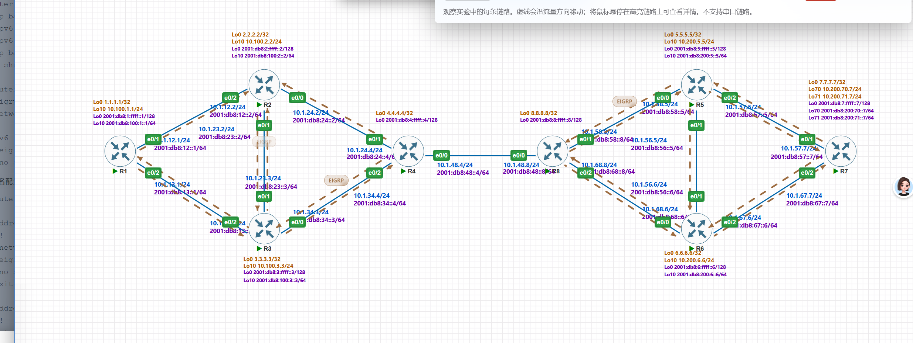

3. 请提交 R1、R7 的默认路由验证截图
R1
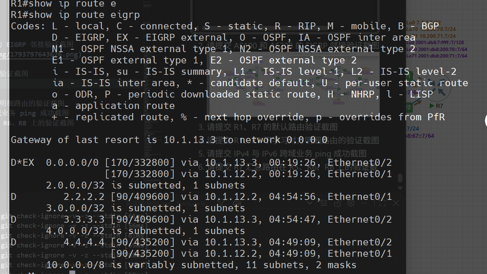
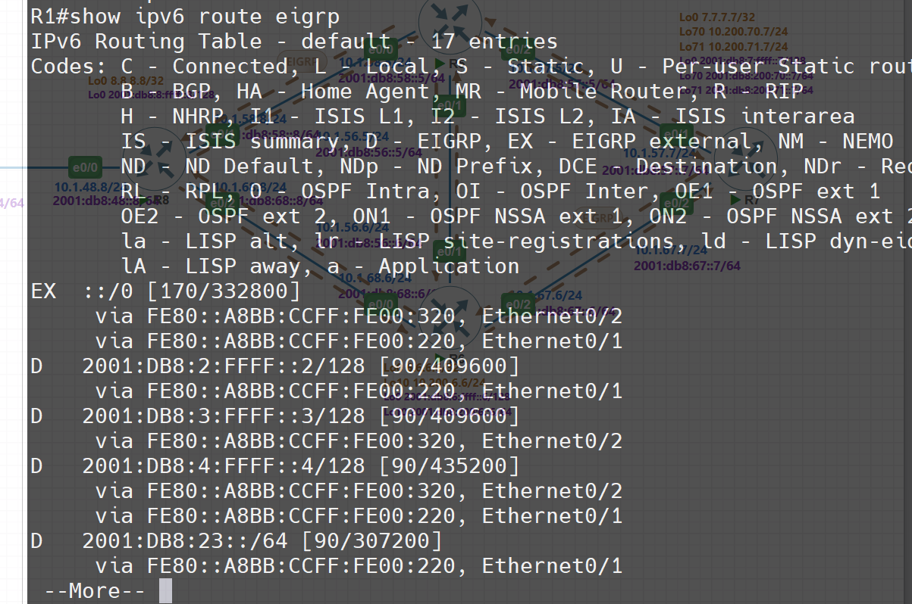
R7
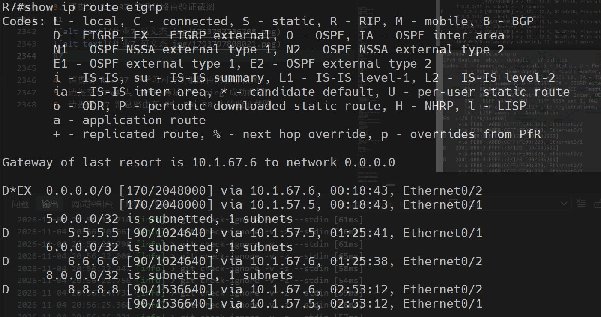
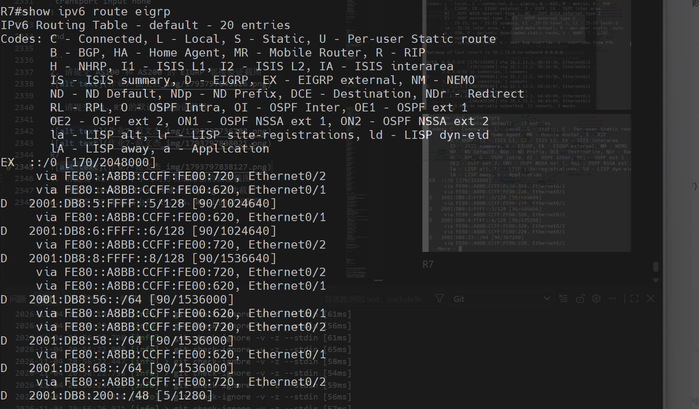
4. 请提交 R1、R7 不学习对方明细路由的验证截图
r1:
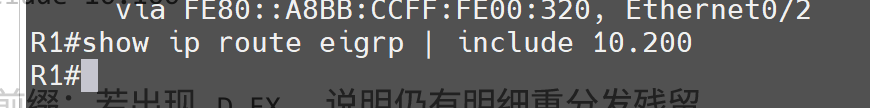
r7
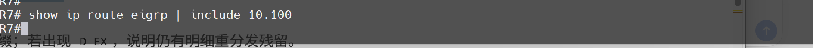
5. 请提交 IPv4 与 IPv6 跨域业务 ping 成功截图
ipv4
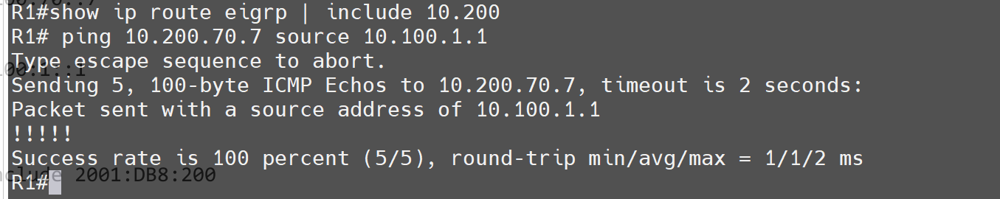
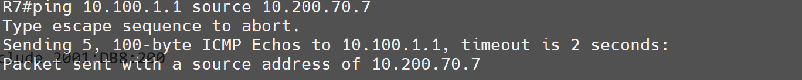

ipv6:
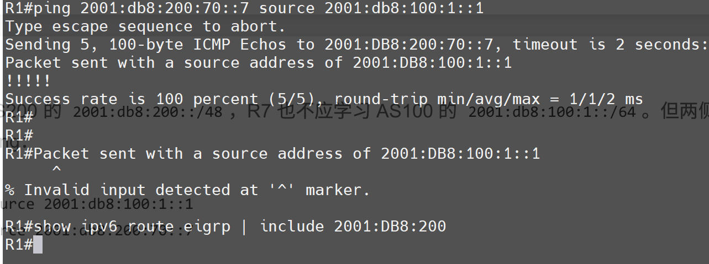
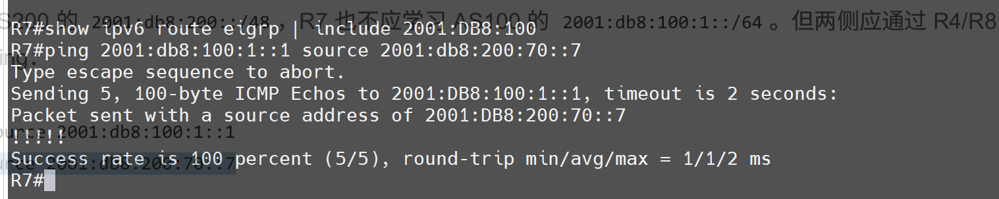
6. 请提交 R7 汇总路由在 R5、R6、R8 上的验证截图
r5
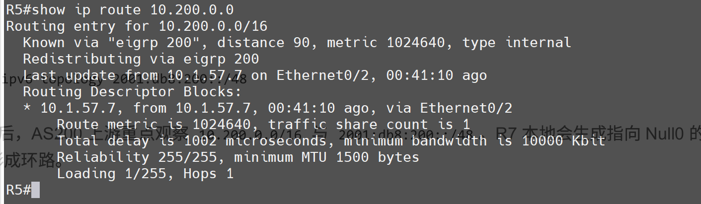
r6:
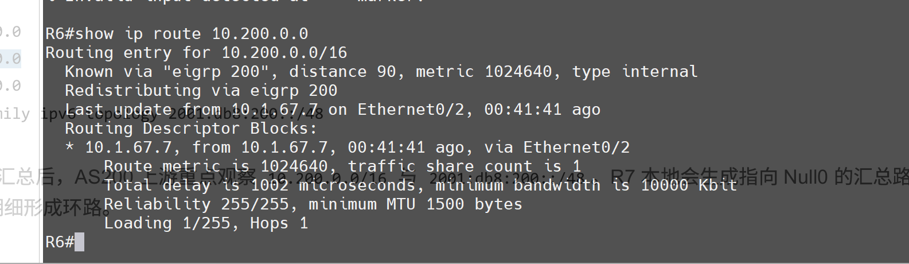
r8:
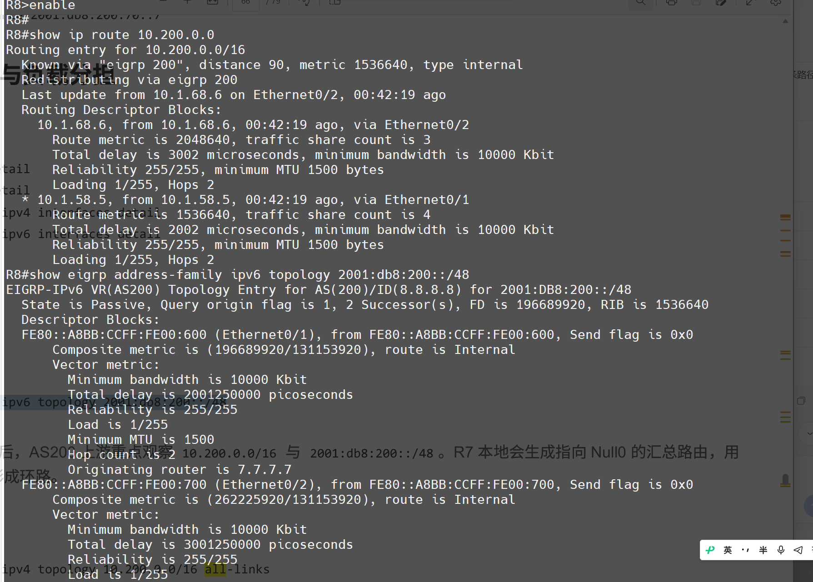